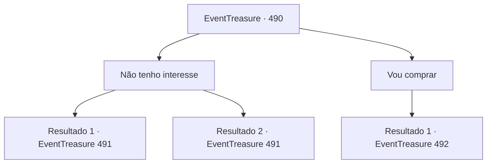

# Eventos de tesouro · 490

[Índice da tabela](index.md) · [Índice geral](../index.md)

ID: `pt:EventTreasure:490` · Fonte: `EventTreasure4` · Versão: 1.2.47.

Mapeamento estático dos arquivos; a disponibilidade e a execução dependem do estado da run.

## Texto do evento

|drawing_tavern| Você encontrou hospedagem numa pequena taverna da vila. Enquanto você jantava, um comerciante vestido com sedas luxuosas aproximou-se da sua mesa. Com um sorriso gentil, ele se sentou. 

 "Seria você, por acaso, {1}? Ouvi muito sobre o seu grande renome."

  Ele tirou um pergaminho antigo de sua bolsa. Parecia um mapa, coberto de símbolos estranhos e marcado com um 'X'. 

 "Este é um mapa do tesouro de um reino antigo. O cofre está selado com magia, e dentro há riquezas incalculáveis. Eu pretendia vendê-lo por 1.000 de ouro… mas, em apoio a você, {1}, faço por apenas 200 de ouro."


## Dados de entrada

```json
{
  "id": 490,
  "grade": 1,
  "place": "",
  "required": "5_869_0|1_2_40"
}
```

## Mapa das escolhas



## Escolhas e resultados

### Escolha 1

Não tenho interesse

Requisitos e outros campos da escolha:

```json
{
  "required": ""
}
```

#### Resultado 1.1

Algo parecia errado. Se ele fosse realmente um mercador, não venderia um item tão raro por um preço tão baixo. Isso significava que ou não era tão valioso quanto ele afirmava, ou talvez ele nem fosse um mercador. Seus instintos o alertaram bruscamente. Você balançou a cabeça educadamente, recusando sua oferta, enquanto o observava com atenção. Por um breve momento, ele pareceu desconcertado antes de forçar um sorriso natural. E, nesse instante, você flagrou as pupilas dele se alongando verticalmente antes de voltarem a ficar arredondadas. 

 "Ah, entendo... Você é cauteloso. Mas uma oportunidade como esta nunca mais surgirá..."

 Ele suspirou, decepcionado, e então tentou insistir mais uma vez. 

 "Você está mesmo recusando? Se estiver sem ouro, pode me pagar depois."

 Seu olhar penetrante parecia prendê-lo no lugar.

Continuação registrada: [Evento 491](0491.md) na mesma tabela.

```json
{
  "required": "",
  "chance": "1|0_14_1",
  "nextEvent": 491,
  "type": 0,
  "reward": "5_870_1"
}
```

#### Resultado 1.2

Você balançou a cabeça educadamente, recusando a oferta dele. O mercador pareceu surpreso por um instante e então recompôs-se com um sorriso. 

 "Ah, entendo... Você é cauteloso(a). Mas uma oportunidade como esta não voltará a aparecer..."

 Com um olhar de pesar, ele guardou o mapa de volta na bolsa e começou a se afastar. Mas então ele parou e se voltou para você novamente. 

 "Você está realmente recusando? Se não tiver ouro suficiente, eu lhe dou agora — você pode me pagar depois."

 Seu olhar intenso parecia prendê-lo(a) no lugar.

Continuação registrada: [Evento 491](0491.md) na mesma tabela.

```json
{
  "required": "",
  "chance": "15",
  "nextEvent": 491,
  "type": 1,
  "reward": ""
}
```

### Escolha 2

Vou comprar

Requisitos e outros campos da escolha:

```json
{
  "required": "1_4_200"
}
```

#### Resultado 2.1

Você pagou ao mercador 200 moedas de ouro e comprou o mapa. Ele sorriu satisfeito e lhe deu algumas instruções. 

 "Lembre-se disso: você deve ir sozinho."

 Com um sorriso enigmático, o mercador partiu.  

  Na noite seguinte, você seguiu o mapa até as ruínas. Eram os restos sinistros de um templo antigo, projetando sombras estranhas ao luar. Quando você entrou, uma voz surgiu das trevas. 

 "Heh heh heh... Eu estava esperando por você."

 Com um rosnado, as tochas nas paredes do templo subitamente se acenderam, ardendo com chamas azuis. E, no altar, estava sentado o mesmo mercador que você havia encontrado no dia anterior. Seus olhos brilhavam com uma luz verde sinistra, mesmo no escuro.

Continuação registrada: [Evento 492](0492.md) na mesma tabela.

```json
{
  "required": "",
  "chance": "1",
  "nextEvent": 492,
  "type": 2,
  "reward": "0_4_-200|3_375_1"
}
```

## Referências que chegam a este evento

Nenhum `nextEvent` positivo da mesma tabela aponta para este nó. Isso não prova que seja inacessível: sorteio e estado de história podem selecioná-lo.

