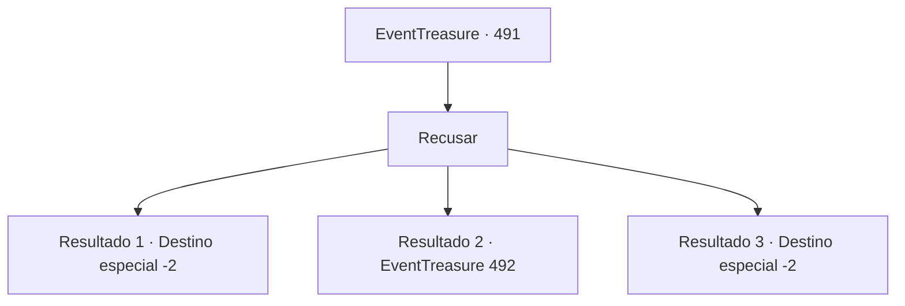

# Eventos de tesouro · 491

[Índice da tabela](index.md) · [Índice geral](../index.md)

ID: `pt:EventTreasure:491` · Fonte: `EventTreasure4` · Versão: 1.2.47.

Mapeamento estático dos arquivos; a disponibilidade e a execução dependem do estado da run.

## Texto do evento

*Sem texto no arquivo.*

## Dados de entrada

```json
{
  "id": 491,
  "grade": 1,
  "place": "",
  "required": ""
}
```

## Mapa das escolhas



## Escolhas e resultados

### Escolha 1

Recusar

Requisitos e outros campos da escolha:

```json
{
  "required": ""
}
```

#### Resultado 1.1

Você recusou a oferta do comerciante mais uma vez. Com isso, ele recuou ligeiramente e falou. 

 "... Muito bem. Uma pena, mas não há o que fazer."

 Relutante, ele enfiou o mapa de volta no bolso e se afastou. Ao partir, não se ouviu um único passo. Você teve uma forte sensação de que ele apareceria novamente algum dia.

Continuação registrada: [Destino especial `-2`](../destinos-especiais.md).

```json
{
  "required": "24_7_1|18_870_1",
  "chance": "1|0_14_1",
  "nextEvent": -2,
  "type": 0,
  "reward": "5_869_1"
}
```

#### Resultado 1.2

Você aceitou o mapa do mercador como se sob um feitiço. Ele sorriu, satisfeito, e deu alguns avisos junto com o mapa. 

 "Lembre-se disto. Você deve ir sozinho."

 O mercador partiu com uma risada significativa.  Na noite seguinte, você seguiu para as ruínas marcadas no mapa. Eram os sinistros restos de um antigo templo, projetando sombras grotescas sob o luar. Quando você entrou no templo abandonado, uma voz saiu da escuridão. 

 "Heh heh heh… Eu estava esperando."

 Num tom rosnado e gutural, as tochas penduradas nas paredes do templo acenderam-se sozinhas com chamas azuis.  O interior do templo revelou-se. Paredes de pedra branca, desgastadas, estavam rachadas e desmoronando, e no centro erguia-se um altar de pedra negra. Sentado sobre esse altar estava o próprio mercador que você havia encontrado antes, observando você com olhos que brilhavam com uma luz verde sinistra na escuridão.

Continuação registrada: [Evento 492](0492.md) na mesma tabela.

```json
{
  "required": "24_7_1|18_870_1",
  "chance": "20",
  "nextEvent": 492,
  "type": 1,
  "reward": ""
}
```

#### Resultado 1.3

Você recusou a oferta do comerciante mais uma vez. Com isso, ele recuou ligeiramente e falou. 

 "... Muito bem. É uma pena, mas não há o que fazer."

 Relutante, enfiou o mapa de volta no bolso e se afastou. Ao partir, não se ouviu sequer um passo.

Continuação registrada: [Destino especial `-2`](../destinos-especiais.md).

```json
{
  "required": "-1|23_7_1|5_870_1",
  "chance": "1",
  "nextEvent": -2,
  "type": 2,
  "reward": "5_869_1"
}
```

## Referências que chegam a este evento

- [Evento 490 · escolha 1 · resultado 1](0490.md#escolha-1)
- [Evento 490 · escolha 1 · resultado 2](0490.md#escolha-1)
