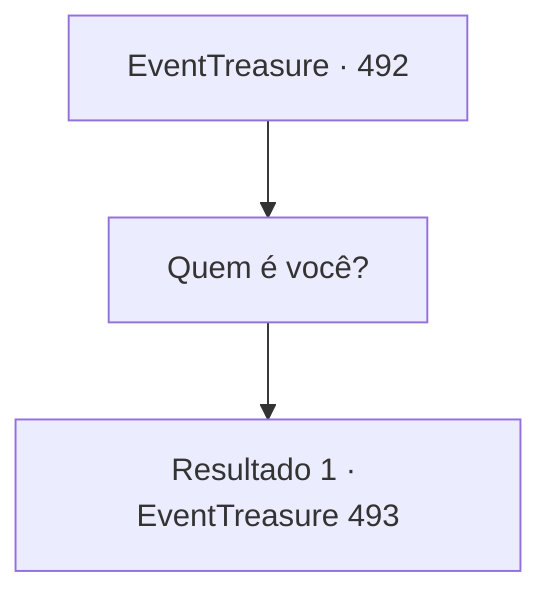

# Eventos de tesouro · 492

[Índice da tabela](index.md) · [Índice geral](../index.md)

ID: `pt:EventTreasure:492` · Fonte: `EventTreasure4` · Versão: 1.2.47.

Mapeamento estático dos arquivos; a disponibilidade e a execução dependem do estado da run.

## Texto do evento

*Sem texto no arquivo.*

## Dados de entrada

```json
{
  "id": 492,
  "grade": 1,
  "place": "",
  "required": ""
}
```

## Mapa das escolhas



## Escolhas e resultados

### Escolha 1

Quem é você?

Requisitos e outros campos da escolha:

```json
{
  "required": ""
}
```

#### Resultado 1.1

Em resposta à sua pergunta, ele desceu do altar e acenou com a mão. Nesse instante, pilhas de ouro cintilante e tesouros apareceram, enchendo o templo. A forma do comerciante mudou, revelando sua verdadeira forma: uma besta com corpo de homem e cabeça de tigre. 

 "Eu sou Rakshasa. Alguns me chamam de Nachal."

 Ele arreganhou as presas num sorriso. 

 "Pois bem… Lutar com você diretamente seria entediante. Vamos fazer uma aposta. Se você vencer, todo este tesouro será seu. Mas se você perder, tomarei sua alma por toda a eternidade."


Continuação registrada: [Evento 493](0493.md) na mesma tabela.

```json
{
  "required": "",
  "chance": "1",
  "nextEvent": 493,
  "type": 2,
  "reward": ""
}
```

## Referências que chegam a este evento

- [Evento 490 · escolha 2 · resultado 1](0490.md#escolha-2)
- [Evento 491 · escolha 1 · resultado 2](0491.md#escolha-1)
