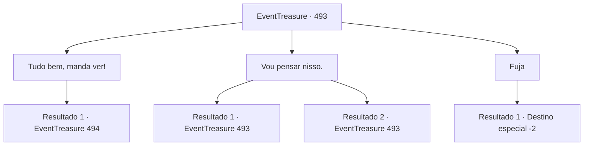

# Eventos de tesouro · 493

[Índice da tabela](index.md) · [Índice geral](../index.md)

ID: `pt:EventTreasure:493` · Fonte: `EventTreasure4` · Versão: 1.2.47.

Mapeamento estático dos arquivos; a disponibilidade e a execução dependem do estado da run.

## Texto do evento

*Sem texto no arquivo.*

## Dados de entrada

```json
{
  "id": 493,
  "grade": 1,
  "place": "",
  "required": ""
}
```

## Mapa das escolhas



## Escolhas e resultados

### Escolha 1

Tudo bem, manda ver!

Requisitos e outros campos da escolha:

```json
{
  "required": ""
}
```

#### Resultado 1.1

Você aceitou corajosamente o desafio do Rakshasa. Com um único gesto, ele invocou mais de uma dúzia de clones de si mesmo. 

 "Hehe… Bom. Vou com calma e vou saborear a diversão."

 Imediatamente, as réplicas do Rakshasa desencadearam uma saraivada de feitiços na sua direção.

Continuação registrada: [Evento 494](0494.md) na mesma tabela.

```json
{
  "required": "",
  "chance": "1",
  "nextEvent": 494,
  "type": 2,
  "reward": "6_0_193",
  "place": 7
}
```

### Escolha 2

Vou pensar nisso.

Requisitos e outros campos da escolha:

```json
{
  "required": "5_871_0"
}
```

#### Resultado 2.1

Você percebeu que o Rakshasa havia deixado deliberadamente partes de sua proposta vagas. ‘Todo esse tesouro será seu.’ Mas eram realmente um tesouro? E então? Não havia nada de certo em suas palavras. O tesouro poderia ser falso, e não havia garantia de que ele permitiria que você saísse vivo. Ao ouvir sua resposta, o Rakshasa olhou para você com claro desagrado.

Continuação registrada: [Evento 493](0493.md) na mesma tabela.

```json
{
  "required": "",
  "chance": "1|0_14_1",
  "nextEvent": 493,
  "type": 0,
  "reward": "5_871_1"
}
```

#### Resultado 2.2

Você fez uma pausa, tentando considerar seu verdadeiro propósito. Mas, sob o olhar do Rakshasa, sua mente ficou em branco, como uma folha de papel em branco. Ele olhou para você com uma expressão divertida e perguntou: 

 "Já terminou de pensar?"


Continuação registrada: [Evento 493](0493.md) na mesma tabela.

```json
{
  "required": "",
  "chance": "20",
  "nextEvent": 493,
  "type": 1,
  "reward": "5_871_9"
}
```

### Escolha 3

Fuja

Requisitos e outros campos da escolha:

```json
{
  "required": ""
}
```

#### Resultado 3.1

Você recuou lentamente, então se virou e saiu em disparada. O Rakshasa conjurou ilusões, tentando aprisioná-lo em alucinações, mas você fechou os olhos e correu às cegas de volta pelo caminho por onde viera. 

 "Maldito mortal! Pare aí mesmo!"

 Seu grito enfurecido ecoou atrás de você quando irrompeu do templo em ruínas, escapando das garras do Rakshasa.

Continuação registrada: [Destino especial `-2`](../destinos-especiais.md).

```json
{
  "required": "",
  "chance": "1",
  "nextEvent": -2,
  "type": 2,
  "reward": "5_869_2"
}
```

## Referências que chegam a este evento

- [Evento 492 · escolha 1 · resultado 1](0492.md#escolha-1)
- [Evento 493 · escolha 2 · resultado 1](0493.md#escolha-2)
- [Evento 493 · escolha 2 · resultado 2](0493.md#escolha-2)
