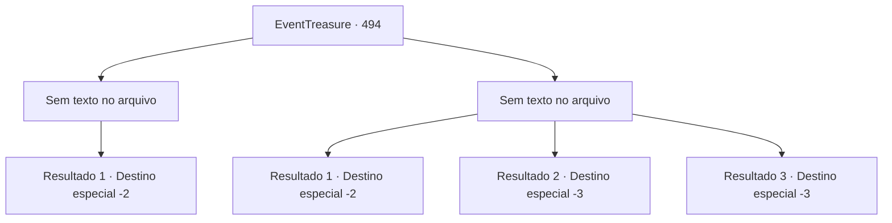

# Eventos de tesouro · 494

[Índice da tabela](index.md) · [Índice geral](../index.md)

ID: `pt:EventTreasure:494` · Fonte: `EventTreasure4` · Versão: 1.2.47.

Mapeamento estático dos arquivos; a disponibilidade e a execução dependem do estado da run.

## Texto do evento

*Sem texto no arquivo.*

## Dados de entrada

```json
{
  "id": 494,
  "grade": 1,
  "place": "",
  "required": ""
}
```

## Mapa das escolhas



## Escolhas e resultados

### Escolha 1

*Sem texto no arquivo; o papel dessa opção depende da interface do jogo.*

Requisitos e outros campos da escolha:

```json
{
  "required": ""
}
```

#### Resultado 1.1

Você esmurrrou o Rakshasa, e ele recuou cambaleando, em pânico, gritando: 

 "Maldição…! Impossível. Como alguém como você…"

 Ele espalhou ilusões, desesperado, para escapar da sua perseguição, e então fugiu do templo. Quando desapareceu, o ouro e os tesouros se desfizeram no ar, deixando para trás apenas teias de aranha, poeira e luar dentro do templo. Você deu as costas à ruína vazia e foi embora.

Continuação registrada: [Destino especial `-2`](../destinos-especiais.md).

```json
{
  "required": "",
  "chance": "1",
  "nextEvent": -2,
  "type": 2,
  "reward": "5_869_9"
}
```

### Escolha 2

*Sem texto no arquivo; o papel dessa opção depende da interface do jogo.*

Requisitos e outros campos da escolha:

```json
{
  "required": ""
}
```

#### Resultado 2.1

Você desabou sob o ataque do Rakshasa. A criatura mostrou as presas em uma risada orgulhosa e arrogante. 

 "Mortal tolo. Você realmente pensou que podia se opor a mim?"

 Nesse instante, você agarrou uma coluna próxima, cuja tocha ardia em azul, e a golpeou na cabeça do Rakshasa. As chamas azuis agarraram-se ao seu pelo, e ele se contorceu para apagá-las. 

 "Graahh! Verme maldito!"

 Você aproveitou para disparar em direção à saída do templo. Embora o Rakshasa tenha conjurado ilusões para enredar você, você fechou os olhos e correu às cegas de volta pelo caminho por onde viera. 

 "Miserável! Pare onde está!"

 Deixando para trás seus brados furiosos, você escapou do templo em ruínas e das garras do Rakshasa.

Continuação registrada: [Destino especial `-2`](../destinos-especiais.md).

```json
{
  "required": "1_0_2|1_1_2",
  "chance": "1",
  "nextEvent": -2,
  "type": 2,
  "reward": "5_869_9|0_0_-1|0_1_-1"
}
```

#### Resultado 2.2

Você tombou sob os golpes do Rakshasa, e seus olhos brilhavam com uma sinistra luz azul enquanto ele se aproximava. Então, com presas afiadas, cravou os dentes no seu pescoço. O sangue jorrou do ferimento, e, do chão sob você, emanou do círculo mágico um sinistro brilho vermelho-azulado, drenando a sua alma. 

 "Khahahaha! Sua alma será um ótimo banquete para mim!"

 Com a risada do Rakshasa ecoando, sua alma deixou de existir.

Continuação registrada: [Destino especial `-3`](../destinos-especiais.md).

```json
{
  "required": "2_0_2",
  "chance": "1",
  "nextEvent": -3,
  "type": 2,
  "reward": "0_0_-1|0_1_-1"
}
```

#### Resultado 2.3

Você tombou sob os golpes do Rakshasa, e seus olhos brilhavam com uma sinistra luz azul enquanto ele se aproximava. Então, com presas afiadas, cravou os dentes no seu pescoço. O sangue jorrou do ferimento, e, do chão sob você, emanou do círculo mágico um sinistro brilho vermelho-azulado, drenando a sua alma. 

 "Khahahaha! Sua alma será um ótimo banquete para mim!"

 Com a risada do Rakshasa ecoando, sua alma deixou de existir.

Continuação registrada: [Destino especial `-3`](../destinos-especiais.md).

```json
{
  "required": "2_1_2",
  "chance": "1",
  "nextEvent": -3,
  "type": 2,
  "reward": "0_0_-1|0_1_-1"
}
```

## Referências que chegam a este evento

- [Evento 493 · escolha 1 · resultado 1](0493.md#escolha-1)
