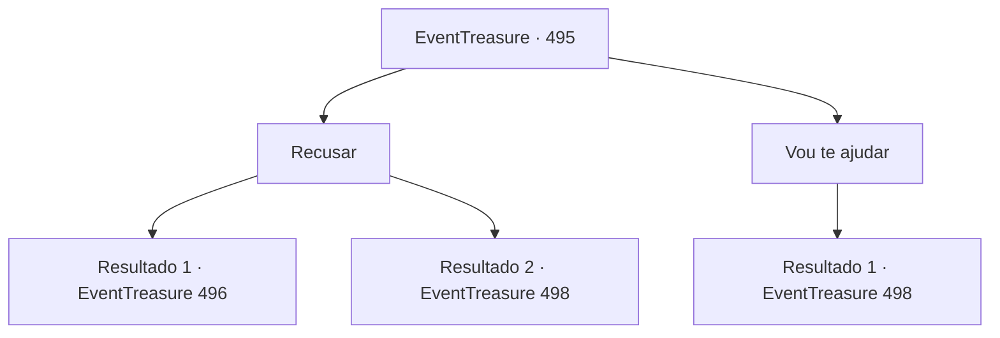

# Eventos de tesouro · 495

[Índice da tabela](index.md) · [Índice geral](../index.md)

ID: `pt:EventTreasure:495` · Fonte: `EventTreasure4` · Versão: 1.2.47.

Mapeamento estático dos arquivos; a disponibilidade e a execução dependem do estado da run.

## Texto do evento

Você estava descansando numa pequena estalagem à beira da estrada quando uma conversa da mesa ao lado chegou aos seus ouvidos. Uma era uma jovem de cabelos alaranjados, vestida com roupas de agricultora, e o outro era um homem de meia-idade que parecia um herborista.  

 "É verdade! Aquela erva chamada ‘Erva Lua Prateada’ pode neutralizar qualquer veneno. E mais: se você a comer, sua resistência a venenos aumenta permanentemente!"

  Abaixaram a voz, como se receosos de serem ouvidos.  

 "Eu obtive uma informação segura. Ela cresce sob uma árvore ancestral nos pântanos do norte."

 "Ah, qual é… Ouvi dizer que monstros aparecem naqueles pântanos. Mesmo que a Erva Lua Prateada esteja lá…"

  Os dois continuaram sussurrando entre si, mas então seus olhos se voltaram para você.  A mulher de cabelos alaranjados levantou-se do assento e aproximou-se. Ela explicou que ela e o herborista queriam colher a erva, mas precisavam de alguém que os protegesse dos monstros do pântano.  

 "Você parece um aventureiro capaz, então me perdoe por pedir isso do nada… Por favor, nós te imploramos, ajude-nos."


## Dados de entrada

```json
{
  "id": 495,
  "grade": 1,
  "place": "",
  "required": "5_869_1|1_2_50"
}
```

## Mapa das escolhas



## Escolhas e resultados

### Escolha 1

Recusar

Requisitos e outros campos da escolha:

```json
{
  "required": ""
}
```

#### Resultado 1.1

Você percebeu algo incomum na mulher aparentemente comum e recusou imediatamente o pedido deles. Eles hesitaram por um momento antes de voltar aos seus lugares, sussurrando baixo demais para você ouvir. De qualquer forma, você se levantou e subiu para o seu quarto para dormir. 

 Na manhã seguinte, você acordou com o corpo rígido e saiu da cama. Enquanto descia as escadas de madeira rangentes, você encontrou o estalajadeiro. Ao ver você, ele falou imediatamente. 

 "Aventureiro. Você sabe de algo sobre a mulher ruiva e o herborista que estavam sentados aqui ontem?"


Continuação registrada: [Evento 496](0496.md) na mesma tabela.

```json
{
  "required": "",
  "chance": "1|0_14_1",
  "nextEvent": 496,
  "type": 0,
  "reward": ""
}
```

#### Resultado 1.2

Você tentou recusar o pedido deles, mas assim que encontrou o olhar da mulher ruiva, um sentimento poderoso irrompeu dentro de você de que precisava ajudá-la. Antes que percebesse, você assentiu, e ela sorriu. 

 "Obrigada, {1}."

  Um alerta ecoou em sua mente: ‘Eu cheguei a dizer a ela o meu nome?’ Ainda assim, seus pés já os seguiam em direção ao pântano.  O pântano era profundo e ameaçador. Cada passo afundava na lama sugadora, e insetos estranhos zumbiam por toda parte. O herbalista ia à frente, enquanto a mulher ruiva caminhava ao seu lado. Curiosamente, o suposto monstro que diziam assombrar o pântano não apareceu.  

 "Ali está! A árvore ancestral!"

 Ela apontou para a frente e, de fato, uma enorme árvore morta estava ali, ramos nus arranhando o céu. E sob ela crescia uma erva de tonalidade prateada de beleza estonteante.  O herbalista esfregou os olhos, incrédulo, exclamando surpreso. 

 "É real...? Nunca a vi ali antes — quando foi que cresceu assim?"

 Ele correu às pressas em direção à base da árvore ancestral.

Continuação registrada: [Evento 498](0498.md) na mesma tabela.

```json
{
  "required": "",
  "chance": "20",
  "nextEvent": 498,
  "type": 1,
  "reward": ""
}
```

### Escolha 2

Vou te ajudar

Requisitos e outros campos da escolha:

```json
{
  "required": ""
}
```

#### Resultado 2.1

Você assentiu, e ela sorriu calorosamente. 

 "Obrigada, {1}."

  Junto com o herborista e a mulher ruiva, você partiu para o pântano onde diziam que o monstro espreitava.  O pântano era profundo e ameaçador. Cada passo afundava na lama, enquanto insetos estranhos enxameavam e zumbiam ao seu redor. O herborista guiava o caminho, enquanto a mulher ruiva caminhava ao seu lado. Ainda assim, estranhamente, o temido monstro nunca apareceu.  

 "Lá está! A árvore ancestral!"

 Ela apontou adiante, onde se erguia uma imponente árvore morta, com galhos nus que se estendiam para o céu. Abaixo dela crescia uma erva prateada reluzente de beleza extraordinária.  O herborista esfregou os olhos, espantado. 

 "É real...? Nunca a vi antes — quando foi que brotou assim?"

 Ele correu, empolgado, em direção à árvore.

Continuação registrada: [Evento 498](0498.md) na mesma tabela.

```json
{
  "required": "",
  "chance": "1",
  "nextEvent": 498,
  "type": 2,
  "reward": ""
}
```

## Referências que chegam a este evento

Nenhum `nextEvent` positivo da mesma tabela aponta para este nó. Isso não prova que seja inacessível: sorteio e estado de história podem selecioná-lo.

