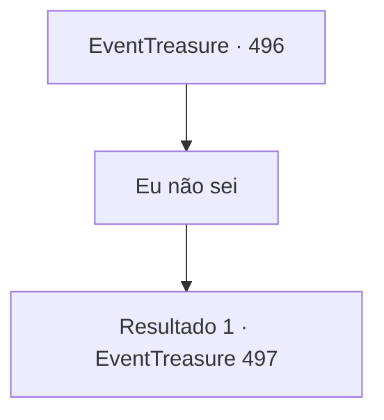

# Eventos de tesouro · 496

[Índice da tabela](index.md) · [Índice geral](../index.md)

ID: `pt:EventTreasure:496` · Fonte: `EventTreasure4` · Versão: 1.2.47.

Mapeamento estático dos arquivos; a disponibilidade e a execução dependem do estado da run.

## Texto do evento

*Sem texto no arquivo.*

## Dados de entrada

```json
{
  "id": 496,
  "grade": 1,
  "place": "",
  "required": ""
}
```

## Mapa das escolhas



## Escolhas e resultados

### Escolha 1

Eu não sei

Requisitos e outros campos da escolha:

```json
{
  "required": ""
}
```

#### Resultado 1.1

Você balançou a cabeça, dizendo que não sabia nada sobre ela. O estalajadeiro suspirou de leve antes de responder. 

 "Bem, ouvi dizer que ela entrou no pântano com o herborista da nossa aldeia, mas aquele nosso amigo herborista... "

  Ele hesitou por um instante, então falou em voz baixa. 

 "Ele está morto. Encontraram-no apavorado, fora de si. A mulher ruiva não estava em lugar nenhum... e, segundo o padre que examinou o corpo, a alma do homem tinha sido sugada."


Continuação registrada: [Evento 497](0497.md) na mesma tabela.

```json
{
  "required": "",
  "chance": "1",
  "nextEvent": 497,
  "type": 2,
  "reward": ""
}
```

## Referências que chegam a este evento

- [Evento 495 · escolha 1 · resultado 1](0495.md#escolha-1)
