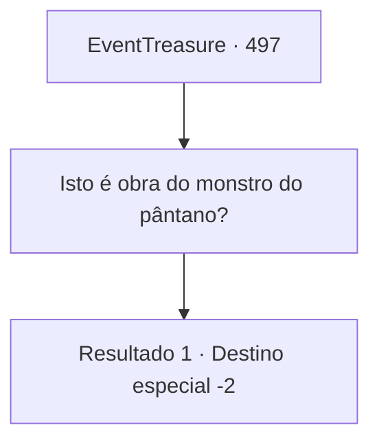

# Eventos de tesouro · 497

[Índice da tabela](index.md) · [Índice geral](../index.md)

ID: `pt:EventTreasure:497` · Fonte: `EventTreasure4` · Versão: 1.2.47.

Mapeamento estático dos arquivos; a disponibilidade e a execução dependem do estado da run.

## Texto do evento

*Sem texto no arquivo.*

## Dados de entrada

```json
{
  "id": 497,
  "grade": 1,
  "place": "",
  "required": ""
}
```

## Mapa das escolhas



## Escolhas e resultados

### Escolha 1

Isto é obra do monstro do pântano?

Requisitos e outros campos da escolha:

```json
{
  "required": ""
}
```

#### Resultado 1.1

Você se lembrou da conversa sobre o monstro do pântano ontem e perguntou se foi isso que matou o herborista. O estalajadeiro balançou a cabeça. 

 "O monstro do pântano é só um crocodilo grande. Ele não suga almas."

  Então, baixando a voz, ele acrescentou: 

 "Aquela mulher de ontem é muito mais suspeita. De qualquer forma, Aventureiro, por favor, tenha cuidado."

  Você assentiu em silêncio e saiu da estalagem.

Continuação registrada: [Destino especial `-2`](../destinos-especiais.md).

```json
{
  "required": "",
  "chance": "1",
  "nextEvent": -2,
  "type": 2,
  "reward": "5_869_9"
}
```

## Referências que chegam a este evento

- [Evento 496 · escolha 1 · resultado 1](0496.md#escolha-1)
