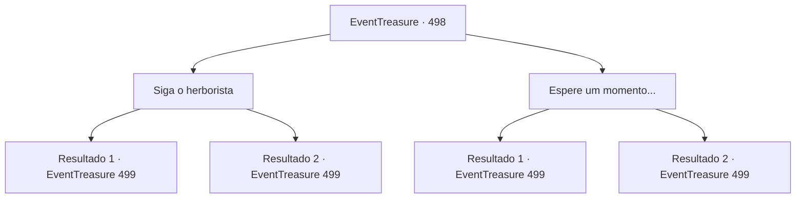

# Eventos de tesouro · 498

[Índice da tabela](index.md) · [Índice geral](../index.md)

ID: `pt:EventTreasure:498` · Fonte: `EventTreasure4` · Versão: 1.2.47.

Mapeamento estático dos arquivos; a disponibilidade e a execução dependem do estado da run.

## Texto do evento

*Sem texto no arquivo.*

## Dados de entrada

```json
{
  "id": 498,
  "grade": 1,
  "place": "",
  "required": ""
}
```

## Mapa das escolhas



## Escolhas e resultados

### Escolha 1

Siga o herborista

Requisitos e outros campos da escolha:

```json
{
  "required": ""
}
```

#### Resultado 1.1

Você também seguiu o herborista até debaixo da antiga árvore. Nesse momento, os padrões complexos gravados no chão começaram a brilhar com uma luz carmesim. Trepadeiras espinhosas murchas irromperam, formando uma enorme gaiola que prendeu você e o herborista. Então, a mulher ruiva irrompeu em uma risada zombeteira. 

 "Hehehe... Como esperado, a ganância dos humanos nunca muda..."

 Suas pupilas se fenderam verticalmente, e sua aparência se desfez como tinta lavada pela água, revelando sua verdadeira forma. Era o rakshasa que o havia atacado antes. O rakshasa apontou um dedo com garras para você e disse: 

 "Desta vez, você não vai escapar."


Continuação registrada: [Evento 499](0499.md) na mesma tabela.

```json
{
  "required": "5_869_2",
  "chance": "1",
  "nextEvent": 499,
  "type": 2,
  "reward": "6_0_193",
  "place": 1
}
```

#### Resultado 1.2

Você também seguiu o herbalista sob a antiga árvore. Nesse momento, os padrões complexos gravados no chão começaram a brilhar com uma luz carmesim. Trepadeiras espinhosas murchas irromperam, formando uma jaula enorme que prendeu você e o herbalista. Então, a mulher ruiva irrompeu em uma risada zombeteira. 

 "Hehehe... Como era de se esperar, a ganância dos humanos nunca muda..."

 Suas pupilas fenderam-se verticalmente, e sua aparência derreteu como tinta lavada pela água, revelando sua verdadeira forma. Era um ser grotesco, com corpo humano e cabeça de tigre. O herbalista entrou em pânico e gritou: 

 "T-temos que fugir!"

 Ele olhou ao redor freneticamente em busca de uma saída, mas não encontrou nenhuma. O demônio de cabeça de tigre arreganhou os dentes e zombou dele. 

 "Você realmente acha que alguém como você pode fugir das garras de um rákshasa?"

 O rákshasa exibiu suas longas garras e avançou lentamente. 

 "Não se preocupe. Vai acabar rápido."


Continuação registrada: [Evento 499](0499.md) na mesma tabela.

```json
{
  "required": "18_869_2",
  "chance": "1",
  "nextEvent": 499,
  "type": 2,
  "reward": "6_0_193",
  "place": 1
}
```

### Escolha 2

Espere um momento...

Requisitos e outros campos da escolha:

```json
{
  "required": "1_14_14"
}
```

#### Resultado 2.1

Você percebeu uma aura sinistra sob a velha árvore. Imediatamente, você agarrou o braço do herborista e o puxou para trás. O herborista ficou sobressaltado. 

 "O-o que você está fazendo?"

 Mas, mais do que a confusão dele, foi a expressão da mulher ruiva que congelou. Assim que seu olhar pousou sobre ela, ela cerrou os dentes e o encarou com ódio. 

 "...Droga. Rápido em perceber, hein."

 As pupilas dela se dividiram verticalmente, e sua aparência derreteu como tinta lavada pela água, revelando sua verdadeira forma. Era o rakshasa que havia atacado você antes. O rakshasa apontou uma garra para você e sibilou: 

 "Eu vou te matar..!"


Continuação registrada: [Evento 499](0499.md) na mesma tabela.

```json
{
  "required": "5_869_2",
  "chance": "1",
  "nextEvent": 499,
  "type": 2,
  "reward": "6_2_193",
  "place": 1
}
```

#### Resultado 2.2

Você percebeu a presença de um círculo mágico sob a velha árvore. Apressadamente, você agarrou o braço do herborista e o puxou para trás. O herborista ficou assustado. 

 "O-o que você está fazendo?"

 Mas, mais do que a confusão dele, foi a expressão da mulher ruiva que congelou. Quando seu olhar recaiu sobre ela, ela cerrou os dentes e lançou-lhe um olhar venenoso. 

 "...Droga. Você percebe rápido, não é?"

 Suas pupilas se dividiram verticalmente, e sua aparência derreteu como tinta lavada pela água, revelando sua verdadeira forma. Era um ser grotesco, com corpo de humano e cabeça de tigre. O herborista entrou em pânico e gritou: 

 "P-precisamos fugir!"

 Ele começou a cambalear para trás, enquanto o demônio de cabeça de tigre mostrava as presas e zombava dele. 

 "Vocês acham mesmo que alguém como vocês pode fugir das garras de um rakshasa?"

 O rakshasa estendeu suas longas garras e avançou lentamente. 

 "Não se preocupe. Vai acabar rápido."


Continuação registrada: [Evento 499](0499.md) na mesma tabela.

```json
{
  "required": "18_869_2",
  "chance": "1",
  "nextEvent": 499,
  "type": 2,
  "reward": "6_2_193",
  "place": 1
}
```

## Referências que chegam a este evento

- [Evento 495 · escolha 1 · resultado 2](0495.md#escolha-1)
- [Evento 495 · escolha 2 · resultado 1](0495.md#escolha-2)
