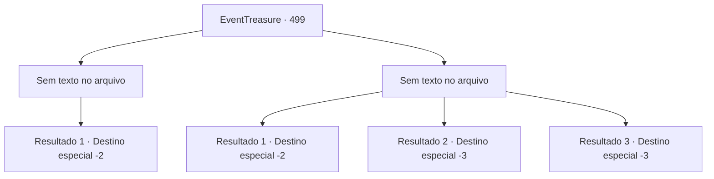

# Eventos de tesouro · 499

[Índice da tabela](index.md) · [Índice geral](../index.md)

ID: `pt:EventTreasure:499` · Fonte: `EventTreasure4` · Versão: 1.2.47.

Mapeamento estático dos arquivos; a disponibilidade e a execução dependem do estado da run.

## Texto do evento

*Sem texto no arquivo.*

## Dados de entrada

```json
{
  "id": 499,
  "grade": 1,
  "place": "",
  "required": ""
}
```

## Mapa das escolhas



## Escolhas e resultados

### Escolha 1

*Sem texto no arquivo; o papel dessa opção depende da interface do jogo.*

Requisitos e outros campos da escolha:

```json
{
  "required": ""
}
```

#### Resultado 1.1

O rakshasa executou gestos de mão complexos e liberou magia de ilusão. De repente, múltiplos rakshasas falsos apareceram, cada um preparando feitiços diferentes. Todos lançaram sua magia ao mesmo tempo — bolas de fogo, relâmpagos, raios congelantes — disparando em sua direção. Em meio ao caos, você observou calmamente os pés deles. E então você notou — apenas o rakshasa real projetava uma sombra no chão. Sem hesitar, você avançou direto contra o verdadeiro. O rakshasa tentou recuar, chocado, mas você já estava perto demais. Seu golpe final derrubou o demônio. 

 "Gah… C-como…"

 O corpo do rakshasa se dissolveu em fumaça negra. Ao mesmo tempo, o círculo mágico e a jaula espinhosa desapareceram. O herbalista, que estava escondido, surgiu e fez uma profunda reverência. 

 "O-obrigado! Aventureiro!"

 Como pagamento por salvar sua vida, ele lhe ofereceu poções e ouro. Exausto, você deixou o pântano e se despediu dele.

Continuação registrada: [Destino especial `-2`](../destinos-especiais.md).

```json
{
  "required": "",
  "chance": "1",
  "nextEvent": -2,
  "type": 2,
  "reward": "5_869_9|3_36_1|3_37_1|0_14_1"
}
```

### Escolha 2

*Sem texto no arquivo; o papel dessa opção depende da interface do jogo.*

Requisitos e outros campos da escolha:

```json
{
  "required": ""
}
```

#### Resultado 2.1

Quando você foi abatido pelo ataque do rakshasa, rolou pelo chão do pântano. Enquanto isso, o herbalista, desesperado para fugir, brandiu sua foice contra as vinhas espinhosas. Para sua surpresa, a lâmina passou direto. 

 "E-essas… essas são ilusões!"

 Tomado por nova esperança, ele tentou escapar pelos espinhos falsos. Mas o rakshasa não tinha intenção de deixá-lo ir. Vinhas mágicas irromperam de sua mão, enroscando-se na perna do herbalista. 

 "Kehaha! Aonde pensa que vai?"

 O rakshasa, eufórico como uma criança com um brinquedo novo, ergueu o herbalista no ar e então o arremessou violentamente contra o pântano. 

 "Aaaghhh!"

 Seus gritos ecoaram pelo pântano. Durante aquele momento de distração, você rastejou silenciosamente em direção à beira do pântano. Enquanto o rakshasa se ocupava com sua vítima, você se livrou da influência do feitiço e disparou numa corrida desesperada. 

 "Pare aí mesmo!"

 O urro enfurecido do demônio perseguiu você, mas já era tarde demais. Você tropeçou ladeira abaixo, rolando e se debatendo até finalmente escapar de seu alcance.

Continuação registrada: [Destino especial `-2`](../destinos-especiais.md).

```json
{
  "required": "1_0_2|1_1_2",
  "chance": "1",
  "nextEvent": -2,
  "type": 2,
  "reward": "0_0_-1|0_1_-1|5_869_9"
}
```

#### Resultado 2.2

Você foi abatido pelo ataque do rakshasa, despencando no chão do pântano. O demônio, eufórico como uma criança com um brinquedo novo, ergueu você no ar e então o arremessou violentamente no pântano. Estrondo! Uma dor agonizante o dominou. E, com isso, sua consciência se esvaiu.

Continuação registrada: [Destino especial `-3`](../destinos-especiais.md).

```json
{
  "required": "2_0_2",
  "chance": "1",
  "nextEvent": -3,
  "type": 2,
  "reward": "0_0_-1|0_1_-1"
}
```

#### Resultado 2.3

Você foi abatido pelo ataque do rakshasa, despencando no chão do pântano. O demônio, eufórico como uma criança com um brinquedo novo, ergueu você no ar e então o arremessou violentamente no pântano. Estrondo! Uma dor agonizante o dominou. E, com isso, sua consciência se esvaiu.

Continuação registrada: [Destino especial `-3`](../destinos-especiais.md).

```json
{
  "required": "2_1_2",
  "chance": "1",
  "nextEvent": -3,
  "type": 2,
  "reward": "0_0_-1|0_1_-1"
}
```

## Referências que chegam a este evento

- [Evento 498 · escolha 1 · resultado 1](0498.md#escolha-1)
- [Evento 498 · escolha 1 · resultado 2](0498.md#escolha-1)
- [Evento 498 · escolha 2 · resultado 1](0498.md#escolha-2)
- [Evento 498 · escolha 2 · resultado 2](0498.md#escolha-2)
