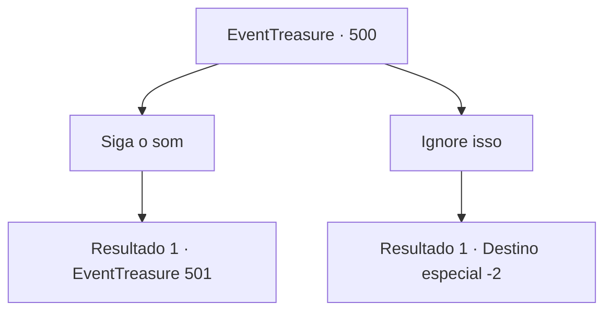

# Eventos de tesouro · 500

[Índice da tabela](index.md) · [Índice geral](../index.md)

ID: `pt:EventTreasure:500` · Fonte: `EventTreasure4` · Versão: 1.2.47.

Mapeamento estático dos arquivos; a disponibilidade e a execução dependem do estado da run.

## Texto do evento

À medida que o crepúsculo se instalava sobre o caminho da floresta, paraste de súbito e aguçaste os ouvidos. Entre o farfalhar das folhas agitadas pelo vento e o chilrear dos pássaros, chegou-te uma melodia artificial. Assemelhava-se ao som de uma trompa, mas havia algo de diferente nela. Pela direção, parecia vir de não muito longe—talvez para além do denso conjunto de carvalhos. A melodia misteriosa trazia a inquietante sensação de te chamar para algum lugar desconhecido.

## Dados de entrada

```json
{
  "id": 500,
  "grade": 2,
  "place": "",
  "required": "1_2_50|5_872_0|26_48_1"
}
```

## Mapa das escolhas



## Escolhas e resultados

### Escolha 1

Siga o som

Requisitos e outros campos da escolha:

```json
{
  "required": ""
}
```

#### Resultado 1.1

Seguindo a melodia, você se deparou com um sátiro soprando uma trompa feita de chifre de carneiro. A parte superior do corpo era humana, mas a inferior era coberta por pelo caprino, com cascos, e no topo da cabeça curvava-se um único chifre majestoso — o outro estava quebrado. O instrumento que ele tocava parecia ter sido feito daquele chifre ausente. |drawing_hornSatyr| Você ficou em silêncio e ouviu. Ele percebeu você e, com um olhar brincalhão, passou a tocar com mais destreza, enchendo a floresta com notas ressonantes que mexiam com o seu peito. Ao terminar, pousou o chifre com seus muitos orifícios, recuperou o fôlego e saltou na sua direção.  

 "Isto se chama bukkehorn. De todo modo, nosso encontro aqui nesta floresta deve ser destino. A deusa do amor deve ter tido pena de mim e enviou você até mim. Não acha?"


Continuação registrada: [Evento 501](0501.md) na mesma tabela.

```json
{
  "required": "",
  "chance": "1",
  "nextEvent": 501,
  "type": 2,
  "reward": "0_1_1"
}
```

### Escolha 2

Ignore isso

Requisitos e outros campos da escolha:

```json
{
  "required": ""
}
```

#### Resultado 2.1

Você ignorou o som e continuou sua jornada.

Continuação registrada: [Destino especial `-2`](../destinos-especiais.md).

```json
{
  "required": "",
  "chance": "1",
  "nextEvent": -2,
  "type": 2,
  "reward": "5_872_9"
}
```

## Referências que chegam a este evento

Nenhum `nextEvent` positivo da mesma tabela aponta para este nó. Isso não prova que seja inacessível: sorteio e estado de história podem selecioná-lo.

