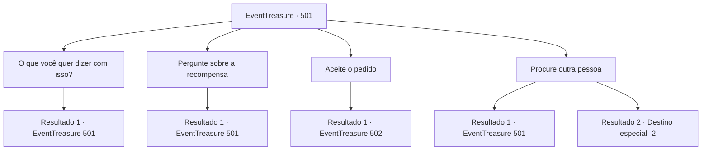

# Eventos de tesouro · 501

[Índice da tabela](index.md) · [Índice geral](../index.md)

ID: `pt:EventTreasure:501` · Fonte: `EventTreasure4` · Versão: 1.2.47.

Mapeamento estático dos arquivos; a disponibilidade e a execução dependem do estado da run.

## Texto do evento

*Sem texto no arquivo.*

## Dados de entrada

```json
{
  "id": 501,
  "grade": 1,
  "place": "",
  "required": ""
}
```

## Mapa das escolhas



## Escolhas e resultados

### Escolha 1

O que você quer dizer com isso?

Requisitos e outros campos da escolha:

```json
{
  "required": "5_873_0"
}
```

#### Resultado 1.1

O sátiro falou com uma graça teatral.  

 "Eu sou Marcia. Eu tive um dia uma amante, uma bela dançarina. Ela me era mais preciosa do que qualquer outra pessoa... Mas…"

  Ele soltou um suspiro pesado.  

 "Ela morreu. Aconteceu enquanto viajava com sua trupe, atravessando as montanhas. Dizem que caiu de um penhasco."

  Ele ergueu o olhar para um pico, cujo cume estava meio velado por nuvens.  

 "Foram as harpias que ocupavam o Monte Kalitz. Elas a lançaram do penhasco."

  Marcia se recompôs e então lhe fez um pedido.  

 "A vingança cabe a mim. Só preciso que você as distraia."

  Ele baixou os olhos para o bukkehorn feito do seu chifre, com uma expressão solene.

Continuação registrada: [Evento 501](0501.md) na mesma tabela.

```json
{
  "required": "",
  "chance": "1",
  "nextEvent": 501,
  "type": 2,
  "reward": "5_873_1"
}
```

### Escolha 2

Pergunte sobre a recompensa

Requisitos e outros campos da escolha:

```json
{
  "required": "5_873_1"
}
```

#### Resultado 2.1

Você perguntou qual seria a recompensa pelo pedido dele. Márcia hesitou e então falou com cuidado.  

 "Sinceramente... não tenho ouro nem bugigangas que os humanos cobicem. Mas tenho algo de maior valor: minha alma. Eu a daria a você."


Continuação registrada: [Evento 501](0501.md) na mesma tabela.

```json
{
  "required": "",
  "chance": "1",
  "nextEvent": 501,
  "type": 2,
  "reward": "5_873_2"
}
```

### Escolha 3

Aceite o pedido

Requisitos e outros campos da escolha:

```json
{
  "required": "5_873_2"
}
```

#### Resultado 3.1

Aceitando o pedido, você assentiu, e Marcia tomou a dianteira.  

 "Tenho esperado por alguém como você. Venha, siga."

  Ele saltou sobre as rochas como uma cabra, guiando você rapidamente montanha acima. Embora fosse difícil manter o ritmo, a ajuda dele permitiu que você escalasse os penhascos com segurança e chegasse ao destino rapidamente.  Ao longo do caminho, você notou pegadas tênues e rastros de carroça.  

 "Vítimas das harpias, sem dúvida. Precisamos nos apressar."

  Marcia prosseguiu à frente enquanto ele falava.

Continuação registrada: [Evento 502](0502.md) na mesma tabela.

```json
{
  "required": "",
  "chance": "1",
  "nextEvent": 502,
  "type": 2,
  "reward": ""
}
```

### Escolha 4

Procure outra pessoa

Requisitos e outros campos da escolha:

```json
{
  "required": "-1|5_873_2|5_873_3"
}
```

#### Resultado 4.1

Você recusou e disse a ele para procurar outra pessoa. Márcia ficou sobressaltada, então agarrou seu pulso.  

 "Espere. O que estou pedindo é lidar com monstros que caçam humanos. Você realmente vai recusar?"


Continuação registrada: [Evento 501](0501.md) na mesma tabela.

```json
{
  "required": "5_873_2",
  "chance": "1",
  "nextEvent": 501,
  "type": 2,
  "reward": "5_872_3"
}
```

#### Resultado 4.2

Você repetiu firmemente sua recusa. Márcia ficou paralisada, olhando para você com o olhar vazio, mas não voltou a impedir você. Deixando-o para trás como uma estátua, você deixou o lugar.

Continuação registrada: [Destino especial `-2`](../destinos-especiais.md).

```json
{
  "required": "5_872_3",
  "chance": "1",
  "nextEvent": -2,
  "type": 2,
  "reward": "5_872_9"
}
```

## Referências que chegam a este evento

- [Evento 500 · escolha 1 · resultado 1](0500.md#escolha-1)
- [Evento 501 · escolha 1 · resultado 1](0501.md#escolha-1)
- [Evento 501 · escolha 2 · resultado 1](0501.md#escolha-2)
- [Evento 501 · escolha 4 · resultado 1](0501.md#escolha-4)
