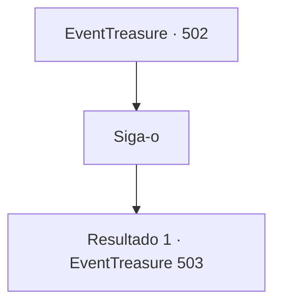

# Eventos de tesouro · 502

[Índice da tabela](index.md) · [Índice geral](../index.md)

ID: `pt:EventTreasure:502` · Fonte: `EventTreasure4` · Versão: 1.2.47.

Mapeamento estático dos arquivos; a disponibilidade e a execução dependem do estado da run.

## Texto do evento

*Sem texto no arquivo.*

## Dados de entrada

```json
{
  "id": 502,
  "grade": 2,
  "place": "",
  "required": ""
}
```

## Mapa das escolhas



## Escolhas e resultados

### Escolha 1

Siga-o

Requisitos e outros campos da escolha:

```json
{
  "required": ""
}
```

#### Resultado 1.1

Seguindo Marcia, você foi subindo lentamente até o cume. O terreno era bastante acidentado, mas, por ser uma rota comercial para carroças, a estrada em si era larga e bem conservada. Marcia remexeu rapidamente em seus pertences e lhe entregou um par de tampões de ouvido de cera. 

 "Aqui. O canto das harpias é perigoso, então pegue estes…"

  Nesse instante, uma melodia tênue chegou aos seus ouvidos. Ela descia de algum lugar nas montanhas, levada pelo vento, fazendo cócegas no seu peito. 

 'La~ la~ la~♪' 

 Antes que percebesse, sua consciência começou a turvar, como se você estivesse escorregando para dentro de um sonho. 

 "Não! Coloque-os rápido! Se você ouvir essa canção, é perigoso!"


Continuação registrada: [Evento 503](0503.md) na mesma tabela.

```json
{
  "required": "",
  "chance": "1",
  "nextEvent": 503,
  "type": 2,
  "reward": ""
}
```

## Referências que chegam a este evento

- [Evento 501 · escolha 3 · resultado 1](0501.md#escolha-3)
