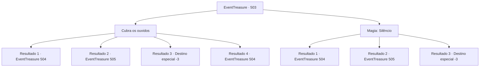

# Eventos de tesouro · 503

[Índice da tabela](index.md) · [Índice geral](../index.md)

ID: `pt:EventTreasure:503` · Fonte: `EventTreasure4` · Versão: 1.2.47.

Mapeamento estático dos arquivos; a disponibilidade e a execução dependem do estado da run.

## Texto do evento

*Sem texto no arquivo.*

## Dados de entrada

```json
{
  "id": 503,
  "grade": 1,
  "place": "",
  "required": ""
}
```

## Mapa das escolhas



## Escolhas e resultados

### Escolha 1

Cubra os ouvidos

Requisitos e outros campos da escolha:

```json
{
  "required": ""
}
```

#### Resultado 1.1

Você rapidamente tapou os ouvidos, abafando o som. Sua consciência, que se esvaía, voltou a se aguçar lentamente. Recuperando o fôlego, você continuou caminhando ao lado de Marcia. Logo, vocês dois chegaram à base de um penhasco imponente, bem alto na montanha. Você ergueu a cabeça e viu harpias circulando acima, com as asas abertas enquanto olhavam para você. Marcia levantou o olhar, as veias saltando no pescoço enquanto ele gritava, 

 "Enquanto eu toco minha música, atraia o olhar delas para você!"

 Graças aos tampões de ouvido, você mal ouviu suas palavras.

Continuação registrada: [Evento 504](0504.md) na mesma tabela.

```json
{
  "required": "21_19_3|21_55_1",
  "chance": "1|0_6_1",
  "nextEvent": 504,
  "type": 0,
  "reward": ""
}
```

#### Resultado 1.2

Você tentou tapar os ouvidos a tempo, mas a doce melodia sobrepujou sua força de vontade primeiro. 

 "Kyaahahaha!"

 Uma risada distante e abafada ecoou em seus ouvidos, como se viesse através da água. De repente, uma dor lancinante, como fogo, atingiu sua cabeça. Você desabou, rolando para trás pelo chão. Quando recuperou um fio de consciência, alguém o sacudia com urgência. 

 "Ei! Você consegue me ver? Está acordado?"

 Virando a cabeça, você viu Marcia, ofegante. Ele ergueu o olhar e gritou, 

 "Enquanto eu toco minha música, chame a atenção deles para você!"

 Graças aos tampões de ouvido, você mal captou as palavras dele.

Continuação registrada: [Evento 505](0505.md) na mesma tabela.

```json
{
  "required": "21_19_3|21_55_1|1_0_2",
  "chance": "15",
  "nextEvent": 505,
  "type": 1,
  "reward": "0_1_-1|6_3_190",
  "place": 9
}
```

#### Resultado 1.3

Você tentou tapar os ouvidos a tempo, mas a doce melodia dominou sua força de vontade antes disso. 

 "Kyaahahaha!"

 O riso zombeteiro das harpias ecoou tenuemente em seus ouvidos, como se estivesse debaixo d’água. De repente, uma dor abrasadora atingiu você como fogo. Você desabou, rolou para trás — e então despencou do penhasco de vez.

Continuação registrada: [Destino especial `-3`](../destinos-especiais.md).

```json
{
  "required": "21_19_3|21_55_1|2_0_2",
  "chance": "15",
  "nextEvent": -3,
  "type": 1,
  "reward": "0_0_-1|0_1_-1"
}
```

#### Resultado 1.4

Com força de vontade de ferro, você resistiu ao canto das harpias. Sua mente se aguçou, e você olhou ao redor com calma. Márcia observou você, surpresa. 

 "Resistir ao canto de uma harpia… você tem uma determinação notável. De qualquer forma, siga-me. Estamos quase lá."

 Você e Márcia seguiram a origem da melodia. Ela descia de um penhasco imponente acima. Ao olhar para cima, você viu harpias circulando, encarando você lá de cima.  

 "Hehehe!"

 "Kyaahahaha!"

  Você se firmou sob o riso zombeteiro delas. Então, Márcia disse com firmeza, 

 "Enquanto eu toco minha canção, você deve atrair os olhares delas para você."


Continuação registrada: [Evento 504](0504.md) na mesma tabela.

```json
{
  "required": "-1|20_55_1|20_19_3",
  "chance": "1",
  "nextEvent": 504,
  "type": 2,
  "reward": ""
}
```

### Escolha 2

Magia: Silêncio

Requisitos e outros campos da escolha:

```json
{
  "required": "20_0_1"
}
```

#### Resultado 2.1

Você lançou Silêncio, cortando todo o som ao seu redor. Sua percepção turva rapidamente voltou a se aguçar. Recuperando o fôlego, você continuou caminhando ao lado de Marcia. Logo, você chegou à base de um penhasco imponente. Ao olhar para cima, você viu harpias circulando com as asas abertas. Marcia tocou seu ombro, sinalizando que ele precisava falar. Você desfez a magia de Silêncio, e ele sussurrou, 

 "Use os tampões de ouvido. Enquanto eu tocar minha música, chame a atenção delas para você."


Continuação registrada: [Evento 504](0504.md) na mesma tabela.

```json
{
  "required": "",
  "chance": "1|0_7_1|0_12_1",
  "nextEvent": 504,
  "type": 0,
  "reward": ""
}
```

#### Resultado 2.2

Você tentou conjurar Silêncio, mas a doce melodia o dominou antes que o feitiço pudesse se formar. 

 "Kyaahahaha!"

 Uma risada distante e abafada ecoou em seus ouvidos, como se carregada pela água. De repente, uma dor lancinante atingiu sua cabeça. Você desabou, rolando para trás pelo chão. Quando você recobrou a consciência, alguém estava sacudindo você. 

 "Ei! Você consegue me ver? Está acordado(a)?"

 Virando a cabeça, você viu Márcia, ofegante. 

 "Use os tampões de ouvido. Enquanto eu toco minha canção, atraia os olhares deles para você."


Continuação registrada: [Evento 505](0505.md) na mesma tabela.

```json
{
  "required": "1_0_2",
  "chance": "30",
  "nextEvent": 505,
  "type": 1,
  "reward": "0_0_-1|6_3_190",
  "place": 9
}
```

#### Resultado 2.3

Você tentou lançar Silêncio, mas a doce melodia o sobrepujou antes que o feitiço se formasse. 

 "Kyaahahaha!"

 As risadas zombeteiras das harpias ecoaram fracamente em seus ouvidos, como se estivesse debaixo d’água. De repente, uma dor lancinante atingiu você como fogo. Você desabou, rolou para trás — e então despencou do penhasco por completo.

Continuação registrada: [Destino especial `-3`](../destinos-especiais.md).

```json
{
  "required": "2_0_2",
  "chance": "30",
  "nextEvent": -3,
  "type": 1,
  "reward": "0_0_-1|0_1_-1"
}
```

## Referências que chegam a este evento

- [Evento 502 · escolha 1 · resultado 1](0502.md#escolha-1)
