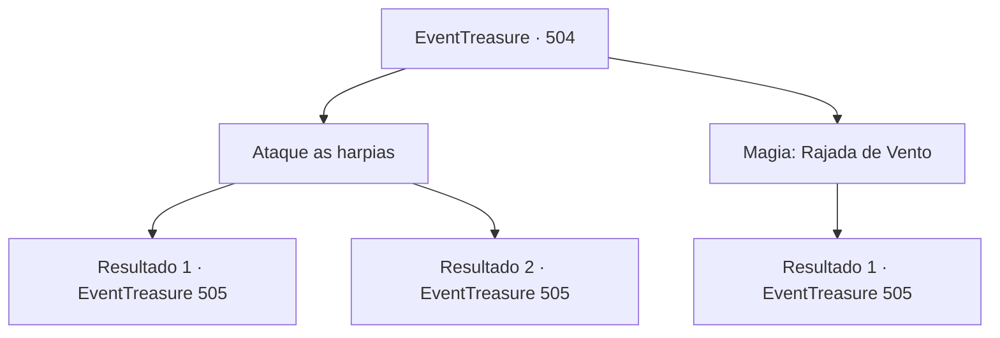

# Eventos de tesouro · 504

[Índice da tabela](index.md) · [Índice geral](../index.md)

ID: `pt:EventTreasure:504` · Fonte: `EventTreasure4` · Versão: 1.2.47.

Mapeamento estático dos arquivos; a disponibilidade e a execução dependem do estado da run.

## Texto do evento

*Sem texto no arquivo.*

## Dados de entrada

```json
{
  "id": 504,
  "grade": 1,
  "place": "",
  "required": ""
}
```

## Mapa das escolhas



## Escolhas e resultados

### Escolha 1

Ataque as harpias

Requisitos e outros campos da escolha:

```json
{
  "required": ""
}
```

#### Resultado 1.1

O bando de harpias voava alto no céu, tornando-as extremamente difíceis de atingir. Sua melhor opção era esperar pelos breves momentos em que elas mergulhavam e contra-atacar. Mas elas tinham número avassalador e velocidade incrível, o que tornava difícil calcular o momento dos seus golpes. Ainda assim, quando surgiu a oportunidade, você não hesitou em revidar. 

 "......!!"

 Uma harpia, pega de surpresa, soltou um guincho e se debateu antes de recuar desajeitadamente de volta aos céus. Seu voo estava instável, como se estivesse ferida. As harpias restantes trocaram olhares inquietos, então retorceram o rosto em esgares e mergulharam em sua direção de uma só vez.

Continuação registrada: [Evento 505](0505.md) na mesma tabela.

```json
{
  "required": "2_6_1",
  "chance": "1",
  "nextEvent": 505,
  "type": 2,
  "reward": "6_3_190",
  "place": 9
}
```

#### Resultado 1.2

Você desferiu um ataque contra as harpias no penhasco. Elas eram rápidas e estavam no ar, o que dificultava seus golpes, mas após várias tentativas, uma delas foi atingida e despencou. 

 "......!!"

 As demais harpias do bando se entreolharam em choque; então, com os rostos contorcidos de raiva, mergulharam todas juntas em sua direção.

Continuação registrada: [Evento 505](0505.md) na mesma tabela.

```json
{
  "required": "1_6_1",
  "chance": "1",
  "nextEvent": 505,
  "type": 2,
  "reward": "6_0_190",
  "place": 9
}
```

### Escolha 2

Magia: Rajada de Vento

Requisitos e outros campos da escolha:

```json
{
  "required": "20_0_1|1_1_2"
}
```

#### Resultado 2.1

Você lançou seu feitiço nas harpias que circundavam o penhasco. Uma rajada feroz encheu o ar, varrendo a borda do penhasco. As harpias foram apanhadas no redemoinho, debatendo-se nas correntes de vento. Algumas perderam completamente o equilíbrio, despencando penhasco abaixo. 

 "......!!"

 As harpias restantes olharam umas para as outras, alarmadas, depois contorceram o rosto de fúria e avançaram contra você como uma só.

Continuação registrada: [Evento 505](0505.md) na mesma tabela.

```json
{
  "required": "",
  "chance": "1",
  "nextEvent": 505,
  "type": 2,
  "reward": "0_1_-1|6_0_190",
  "place": 9
}
```

## Referências que chegam a este evento

- [Evento 503 · escolha 1 · resultado 1](0503.md#escolha-1)
- [Evento 503 · escolha 1 · resultado 4](0503.md#escolha-1)
- [Evento 503 · escolha 2 · resultado 1](0503.md#escolha-2)
