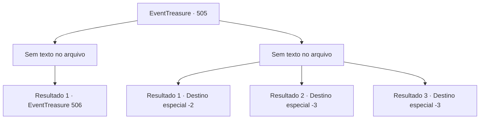

# Eventos de tesouro · 505

[Índice da tabela](index.md) · [Índice geral](../index.md)

ID: `pt:EventTreasure:505` · Fonte: `EventTreasure4` · Versão: 1.2.47.

Mapeamento estático dos arquivos; a disponibilidade e a execução dependem do estado da run.

## Texto do evento

*Sem texto no arquivo.*

## Dados de entrada

```json
{
  "id": 505,
  "grade": 1,
  "place": "",
  "required": ""
}
```

## Mapa das escolhas



## Escolhas e resultados

### Escolha 1

*Sem texto no arquivo; o papel dessa opção depende da interface do jogo.*

Requisitos e outros campos da escolha:

```json
{
  "required": ""
}
```

#### Resultado 1.1

À medida que várias das harpias eram atingidas e caíam, o restante vacilou, circulando cautelosamente como se reconsiderasse o ataque. Mas então, de repente, todas cambalearam e desabaram no chão, apertando as orelhas. Você rapidamente abateu as criaturas contorcidas. Quando você se virou, viu Marcia abaixando a trompa, deslizando os tampões para fora dos próprios ouvidos. Ele fez uma reverência graciosa, como um maestro ao fim de uma apresentação. 

 "Obrigado por me ajudar a vingá-la. As harpias foram uma plateia e tanto para a minha canção."


Continuação registrada: [Evento 506](0506.md) na mesma tabela.

```json
{
  "required": "",
  "chance": "1",
  "nextEvent": 506,
  "type": 2,
  "reward": ""
}
```

### Escolha 2

*Sem texto no arquivo; o papel dessa opção depende da interface do jogo.*

Requisitos e outros campos da escolha:

```json
{
  "required": ""
}
```

#### Resultado 2.1

As harpias eram mestres em explorar seu dom do voo. Sempre que você atacava, elas disparavam para o alto, repetindo rápidos ataques de bate-e-corre para desgastar você. Por fim, quando suas forças chegaram ao limite, uma delas mergulhou por trás e fez você perder o equilíbrio, mandando-o despencar do penhasco. 

 ".....!!"

 Marcia estendeu a mão, desesperada, mas não conseguiu alcançar você. Você despencou para as profundezas abaixo e perdeu a consciência.  Algum tempo depois, seus olhos se entreabriram. Seu corpo havia ficado preso nos galhos espessos de uma árvore enorme. Parecia que você tinha sido agarrado no meio da queda. Marcia não estava em lugar nenhum — só o vento frio assobiava pela floresta. Você desceu com cuidado, apertando as feridas doloridas, e deixou aquele lugar para trás.

Continuação registrada: [Destino especial `-2`](../destinos-especiais.md).

```json
{
  "required": "1_0_2|1_1_2",
  "chance": "1",
  "nextEvent": -2,
  "type": 2,
  "reward": "0_0_-1|0_1_-1|5_872_9"
}
```

#### Resultado 2.2

As harpias eram mestres em explorar o seu dom de voo. Sempre que você atacava, elas disparavam para o alto, repetindo rápidos ataques de bate‑e‑foge para desgastá-lo. Por fim, quando suas forças chegaram ao limite, uma delas mergulhou por trás e o atingiu, tirando-o do equilíbrio e derrubando-o penhasco abaixo. 

 ".....!!"

 Marcia estendeu a mão desesperadamente, mas não conseguiu alcançá-lo. Você despencou nas profundezas abaixo e perdeu a consciência.

Continuação registrada: [Destino especial `-3`](../destinos-especiais.md).

```json
{
  "required": "2_0_2",
  "chance": "1",
  "nextEvent": -3,
  "type": 2,
  "reward": "0_0_-1|0_1_-1"
}
```

#### Resultado 2.3

As harpias eram mestres em explorar o seu dom de voo. Sempre que você atacava, elas disparavam para o alto, repetindo rápidos ataques de bate‑e‑foge para desgastá-lo. Por fim, quando suas forças chegaram ao limite, uma delas mergulhou por trás e o atingiu, tirando-o do equilíbrio e derrubando-o penhasco abaixo. 

 ".....!!"

 Marcia estendeu a mão desesperadamente, mas não conseguiu alcançá-lo. Você despencou nas profundezas abaixo e perdeu a consciência.

Continuação registrada: [Destino especial `-3`](../destinos-especiais.md).

```json
{
  "required": "2_1_2",
  "chance": "1",
  "nextEvent": -3,
  "type": 2,
  "reward": "0_0_-1|0_1_-1"
}
```

## Referências que chegam a este evento

- [Evento 503 · escolha 1 · resultado 2](0503.md#escolha-1)
- [Evento 503 · escolha 2 · resultado 2](0503.md#escolha-2)
- [Evento 504 · escolha 1 · resultado 1](0504.md#escolha-1)
- [Evento 504 · escolha 1 · resultado 2](0504.md#escolha-1)
- [Evento 504 · escolha 2 · resultado 1](0504.md#escolha-2)
