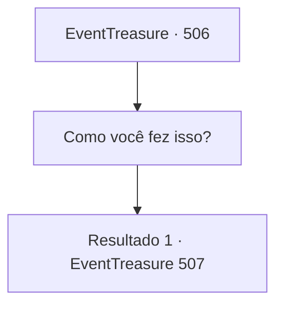

# Eventos de tesouro · 506

[Índice da tabela](index.md) · [Índice geral](../index.md)

ID: `pt:EventTreasure:506` · Fonte: `EventTreasure4` · Versão: 1.2.47.

Mapeamento estático dos arquivos; a disponibilidade e a execução dependem do estado da run.

## Texto do evento

*Sem texto no arquivo.*

## Dados de entrada

```json
{
  "id": 506,
  "grade": 1,
  "place": "",
  "required": ""
}
```

## Mapa das escolhas



## Escolhas e resultados

### Escolha 1

Como você fez isso?

Requisitos e outros campos da escolha:

```json
{
  "required": ""
}
```

#### Resultado 1.1

À sua pergunta, Marcia acariciou a bukkehorn e respondeu. 

 "Foi o meu “Lamento” que toquei. A canção conta a história trágica de um jovem que perseguiu seu amor, apenas para cair em desespero quando percebeu que nunca poderia ficar com ela."

 Era a própria história dele. Marcia então lhe entregou a bukkehorn dele e continuou. 

 "De qualquer forma… minha vingança está concluída. Estou satisfeita. Agora devo lhe dar sua recompensa. Vou lhe ensinar esta canção que guarda minha alma."


Continuação registrada: [Evento 507](0507.md) na mesma tabela.

```json
{
  "required": "",
  "chance": "1",
  "nextEvent": 507,
  "type": 2,
  "reward": "3_376_1"
}
```

## Referências que chegam a este evento

- [Evento 505 · escolha 1 · resultado 1](0505.md#escolha-1)
