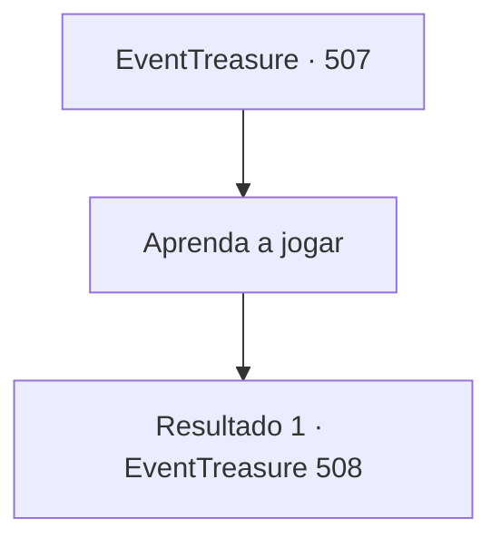

# Eventos de tesouro · 507

[Índice da tabela](index.md) · [Índice geral](../index.md)

ID: `pt:EventTreasure:507` · Fonte: `EventTreasure4` · Versão: 1.2.47.

Mapeamento estático dos arquivos; a disponibilidade e a execução dependem do estado da run.

## Texto do evento

*Sem texto no arquivo.*

## Dados de entrada

```json
{
  "id": 507,
  "grade": 1,
  "place": "",
  "required": ""
}
```

## Mapa das escolhas



## Escolhas e resultados

### Escolha 1

Aprenda a jogar

Requisitos e outros campos da escolha:

```json
{
  "required": ""
}
```

#### Resultado 1.1

Marcia começou a aula. Sem partitura, ele simplesmente fez você seguir a sensação de soprar a bukkehorn, ensinando, frase por frase, enquanto você imitava sua execução. Após a última frase, ele pousou o instrumento e disse, 

 "Ensinei todas as frases. Agora você só precisa tocá-la do começo ao fim."

 Ele deu um tapinha no seu ombro e falou devagar. 

 "…Agora. Toque do começo ao fim."


Continuação registrada: [Evento 508](0508.md) na mesma tabela.

```json
{
  "required": "",
  "chance": "1",
  "nextEvent": 508,
  "type": 2,
  "reward": ""
}
```

## Referências que chegam a este evento

- [Evento 506 · escolha 1 · resultado 1](0506.md#escolha-1)
