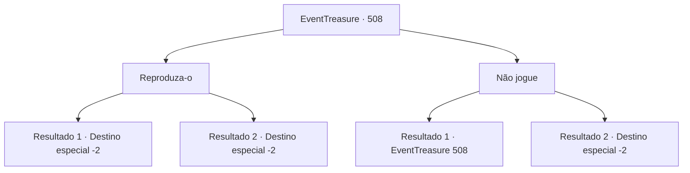

# Eventos de tesouro · 508

[Índice da tabela](index.md) · [Índice geral](../index.md)

ID: `pt:EventTreasure:508` · Fonte: `EventTreasure4` · Versão: 1.2.47.

Mapeamento estático dos arquivos; a disponibilidade e a execução dependem do estado da run.

## Texto do evento

*Sem texto no arquivo.*

## Dados de entrada

```json
{
  "id": 508,
  "grade": 1,
  "place": "",
  "required": ""
}
```

## Mapa das escolhas



## Escolhas e resultados

### Escolha 1

Reproduza-o

Requisitos e outros campos da escolha:

```json
{
  "required": ""
}
```

#### Resultado 1.1

Você fechou os olhos e tocou a bukkehorn lentamente. A melodia começou brilhante e esperançosa, mas aos poucos tornou-se sombria e pesada. Você se entregou à execução, sentindo a dor de Márcia como se fosse sua. Quando a peça finalmente terminou, você abriu os olhos. Não havia mais ninguém no penhasco — apenas marcas de cascos levavam até a beira. Você lamentou a morte de um homem que havia perdido sua amada, então se virou.

Continuação registrada: [Destino especial `-2`](../destinos-especiais.md).

```json
{
  "required": "",
  "chance": "1|0_12_1",
  "nextEvent": -2,
  "type": 0,
  "reward": "27_57_1|5_872_9"
}
```

#### Resultado 1.2

Você fechou os olhos e tocou a bukkehorn lentamente. A melodia começou animada o suficiente, mas logo vacilou e oscilou. Marcia franziu levemente a testa e disse, 

 "…Você precisa de um pouco mais de prática. Ainda assim, obrigado pela ajuda."

 Com isso, ele saltou encosta acima pela face rochosa e desapareceu.

Continuação registrada: [Destino especial `-2`](../destinos-especiais.md).

```json
{
  "required": "",
  "chance": "30",
  "nextEvent": -2,
  "type": 1,
  "reward": "5_872_9"
}
```

### Escolha 2

Não jogue

Requisitos e outros campos da escolha:

```json
{
  "required": ""
}
```

#### Resultado 2.1

Você recusou o pedido final de Marcia. Ele soltou um longo suspiro e balançou a cabeça. 

 "Não tenho vontade de continuar vivendo. Quero encontrá-la o quanto antes… Então, por favor, toque a Marcha Fúnebre para mim. Deixe-me ouvir a música que condiz com o fim da minha vida."

 Marcia caiu de joelhos, olhando para você desesperadamente.

Continuação registrada: [Evento 508](0508.md) na mesma tabela.

```json
{
  "required": "18_874_0",
  "chance": "1",
  "nextEvent": 508,
  "type": 2,
  "reward": "0_3_1|5_874_1"
}
```

#### Resultado 2.2

No fim, você virou as costas à sua súplica. Marcia caiu ao chão, ajoelhou-se e curvou-se com um longo suspiro. 

 "Ah… ó deuses… por quê…"

 Você se afastou, deixando para trás os murmúrios desesperados dele.

Continuação registrada: [Destino especial `-2`](../destinos-especiais.md).

```json
{
  "required": "5_874_1",
  "chance": "1",
  "nextEvent": -2,
  "type": 2,
  "reward": "0_3_1|5_872_9"
}
```

## Referências que chegam a este evento

- [Evento 507 · escolha 1 · resultado 1](0507.md#escolha-1)
- [Evento 508 · escolha 2 · resultado 1](0508.md#escolha-2)
