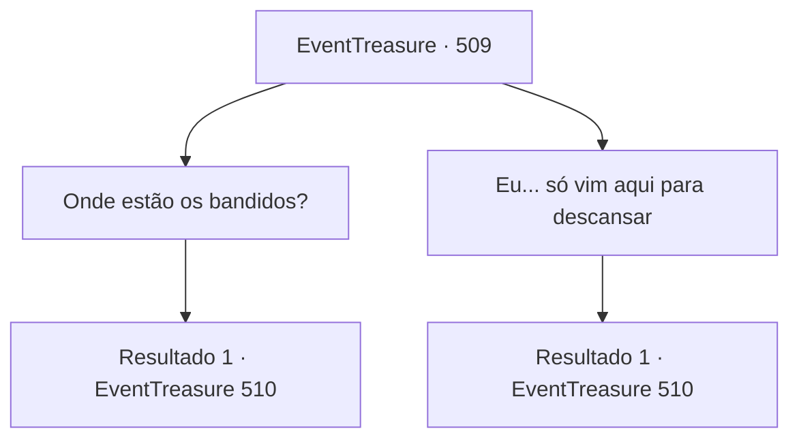

# Eventos de tesouro · 509

[Índice da tabela](index.md) · [Índice geral](../index.md)

ID: `pt:EventTreasure:509` · Fonte: `EventTreasure4` · Versão: 1.2.47.

Mapeamento estático dos arquivos; a disponibilidade e a execução dependem do estado da run.

## Texto do evento

Você está subindo uma pequena colina, abaixo da qual corre um pequeno rio prateado que se bifurca ao redor de uma pequena cidade. É o Rio Alfons, localizado não muito longe do Castelo Briovich. O moinho d’água próximo a ele sustenta um pequeno assentamento de cinco ou seis famílias — a cidade de “Alfonds”. Você decide passar pela cidade para matar a sede e descansar um pouco. Em geral, Alfonds é uma cidade pastoral, pacífica e tranquila. Mas, neste momento, você sente tensão no ar. Então, uma velha senhora que deve ter reconhecido seu rosto se aproxima de você. 

 "M- meu Suserano...?"

 Seus olhos brilham de empolgação. Antes mesmo que você possa responder, ela se inclina e começa a falar alegremente. 

 "E- eu... Obrigada, em nome do povo de Alfonds, o senhor nos honra com sua presença...!"

 Todos os habitantes saem de suas casas e fazem o mesmo. 

 "O senhor poderia ter enviado um cavaleiro, e ainda assim decidiu investigar pessoalmente o assunto, hm?"

 De alguma forma, todos estão convencidos de que você está aqui para lidar com bandidos. Tudo o que você queria era descansar — mas agora, há vários rostos olhando para você com empolgação.

## Dados de entrada

```json
{
  "id": 509,
  "grade": 2,
  "place": "",
  "required": "5_878_1|2_2_10|5_971_0"
}
```

## Mapa das escolhas



## Escolhas e resultados

### Escolha 1

Onde estão os bandidos?

Requisitos e outros campos da escolha:

```json
{
  "required": ""
}
```

#### Resultado 1.1

A velha, que você nota estar segurando uma vassoura, responde. 

 "Ouvimos dizer que são um bando de bandidos que foram expulsos de uma propriedade vizinha... Como se nossa cidade tivesse algo que valesse a pena pegar?! E ainda assim invadem nossas terras e pedem tributo! Roubaram o depósito da cidade até ficar vazio!"

 Quando a voz dela fica rouca de raiva, o filho a interrompe. 

 "Vamos, mãe. Acalme-se."

 Ele se curva diante de você e continua. 

 "Perdão, meu senhor! Os bandidos provavelmente estão escondidos na floresta ali. Eu os vi entrar lá, depois que terminaram de roubar nossa cidade."

 Ele aponta para uma floresta além do rio. Os moradores da cidade voltam todos os olhares para você. Seus olhos brilham de excitação e da confiança de que de alguma forma você fará esse problema de bandidos desaparecer.

Continuação registrada: [Evento 510](0510.md) na mesma tabela.

```json
{
  "required": "",
  "chance": "1",
  "nextEvent": 510,
  "type": 2,
  "reward": ""
}
```

### Escolha 2

Eu... só vim aqui para descansar

Requisitos e outros campos da escolha:

```json
{
  "required": ""
}
```

#### Resultado 2.1

Você lhe diz que está simplesmente aqui para descansar. Você percebe que, de alguma forma, sua resposta foi interpretada errado. 

 "Claro, claro...! Lidar com alguns bandidos deve ser como tirar férias para você, não é?"

 A mulher idosa olha para você com um sorriso. Os moradores ao seu redor fazem o mesmo. Os olhos deles brilham de empolgação e com a fé de que, de alguma forma, você fará esse problema de bandidos desaparecer. Um deles acrescenta. 

 "Ali — o esconderijo deles provavelmente fica na floresta além do rio, meu senhor."


Continuação registrada: [Evento 510](0510.md) na mesma tabela.

```json
{
  "required": "",
  "chance": "1",
  "nextEvent": 510,
  "type": 2,
  "reward": ""
}
```

## Referências que chegam a este evento

Nenhum `nextEvent` positivo da mesma tabela aponta para este nó. Isso não prova que seja inacessível: sorteio e estado de história podem selecioná-lo.

