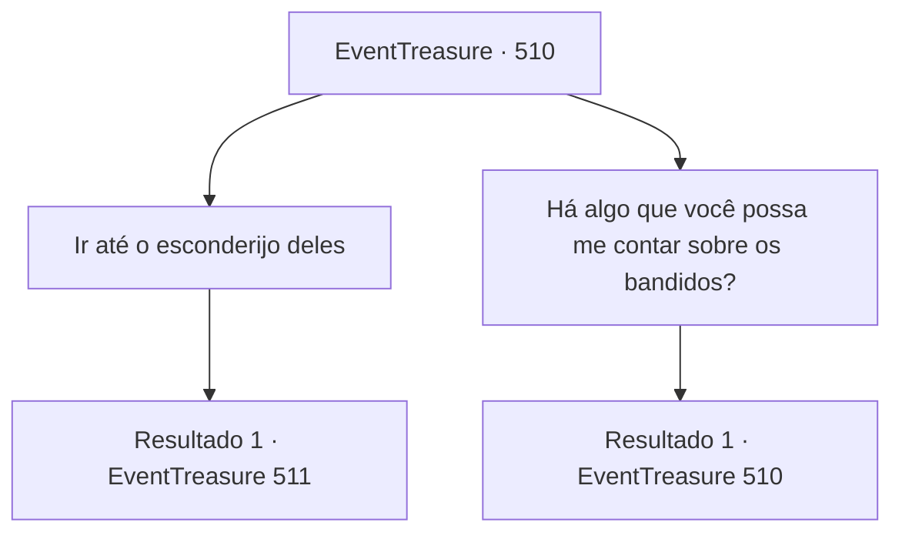

# Eventos de tesouro · 510

[Índice da tabela](index.md) · [Índice geral](../index.md)

ID: `pt:EventTreasure:510` · Fonte: `EventTreasure4` · Versão: 1.2.47.

Mapeamento estático dos arquivos; a disponibilidade e a execução dependem do estado da run.

## Texto do evento

*Sem texto no arquivo.*

## Dados de entrada

```json
{
  "id": 510,
  "grade": 1,
  "place": "",
  "required": ""
}
```

## Mapa das escolhas



## Escolhas e resultados

### Escolha 1

Ir até o esconderijo deles

Requisitos e outros campos da escolha:

```json
{
  "required": ""
}
```

#### Resultado 1.1

Se você deixar esses bandidos em paz, eles acabarão crescendo em poder e espalhando sua influência para outros lugares também. Isso deteriorará ainda mais a confiança que os moradores têm em você. Carregando o desejo do povo nas suas costas, você decide seguir para a floresta onde os bandidos estão escondidos. 

 O ar da floresta está úmido e molhado. O cheiro de terra encharcada e de galhos parcialmente queimados chega ao seu nariz. Logo você encontra um pequeno acampamento, com sinais de uso ainda visivelmente recentes. Quatro tendas gastas estão lá, voltadas umas para as outras. No fogo há uma panela de cozinhar, que ainda tem um pouco de ensopado. Uma pequena fogueira continua a queimar, alimentando-se de um monte de gravetos. Ao lado, você nota cavalos amarrados a um poste de madeira.

Continuação registrada: [Evento 511](0511.md) na mesma tabela.

```json
{
  "required": "",
  "chance": "1",
  "nextEvent": 511,
  "type": 2,
  "reward": ""
}
```

### Escolha 2

Há algo que você possa me contar sobre os bandidos?

Requisitos e outros campos da escolha:

```json
{
  "required": "5_972_0"
}
```

#### Resultado 2.1

Você pergunta aos moradores sobre os bandidos. Então, todos começam a lhe contar o que testemunharam. 

 "Hum... lembro de ter visto cerca de três ou quatro pessoas."

 "Eles não pareciam ladrões comuns. Estavam bem equipados, com armaduras e armas adequadas. Talvez sejam um grupo de desertores..."


Continuação registrada: [Evento 510](0510.md) na mesma tabela.

```json
{
  "required": "",
  "chance": "1",
  "nextEvent": 510,
  "type": 2,
  "reward": "5_972_1"
}
```

## Referências que chegam a este evento

- [Evento 509 · escolha 1 · resultado 1](0509.md#escolha-1)
- [Evento 509 · escolha 2 · resultado 1](0509.md#escolha-2)
- [Evento 510 · escolha 2 · resultado 1](0510.md#escolha-2)
