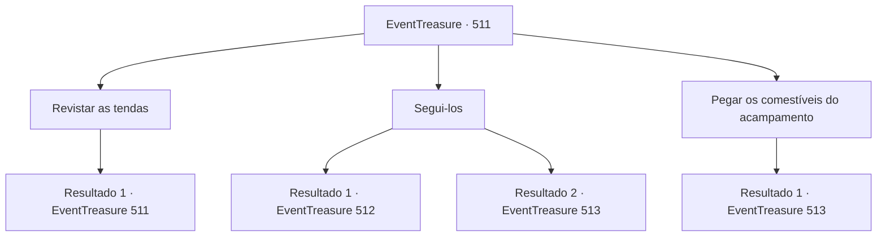

# Eventos de tesouro · 511

[Índice da tabela](index.md) · [Índice geral](../index.md)

ID: `pt:EventTreasure:511` · Fonte: `EventTreasure4` · Versão: 1.2.47.

Mapeamento estático dos arquivos; a disponibilidade e a execução dependem do estado da run.

## Texto do evento

*Sem texto no arquivo.*

## Dados de entrada

```json
{
  "id": 511,
  "grade": 1,
  "place": "",
  "required": ""
}
```

## Mapa das escolhas



## Escolhas e resultados

### Escolha 1

Revistar as tendas

Requisitos e outros campos da escolha:

```json
{
  "required": "5_978_0"
}
```

#### Resultado 1.1

Você examina cuidadosamente as tendas. Dentro de cada tenda há um cobertor velho, claramente usado muitas vezes, sacos de grãos e itens diversos que você supõe não terem sido obtidos legalmente. Ao redor das tendas, você nota pegadas espalhadas, que devem ser dos bandidos.

Continuação registrada: [Evento 511](0511.md) na mesma tabela.

```json
{
  "required": "",
  "chance": "1",
  "nextEvent": 511,
  "type": 2,
  "reward": "5_978_1"
}
```

### Escolha 2

Segui-los

Requisitos e outros campos da escolha:

```json
{
  "required": ""
}
```

#### Resultado 2.1

Você segue as pegadas para perseguir os bandidos. Logo, você os encontra. Eles estão ocupados discutindo qual cidade roubar em seguida, tagarelando e rindo. 

 "Argh, a última cidade que roubamos tinha tão pouca carne. Espero que tenham salsichas da próxima vez."

 Eles não parecem bandidos desesperados que roubam ou morrem de fome. Armadura de placas, capacete de aço, escudo, lança — esses são equipamentos oficiais de nível militar. Você nota o símbolo do grifo em seus escudos — o brasão da Casa Greymoor, sua propriedade vizinha.

Continuação registrada: [Evento 512](0512.md) na mesma tabela.

```json
{
  "required": "",
  "chance": "1|0_14_1",
  "nextEvent": 512,
  "type": 0,
  "reward": ""
}
```

#### Resultado 2.2

Você segue as pegadas para caçar os bandidos. Mas logo as pegadas chegam ao fim. Infelizmente, você decide desistir de seguir as pegadas e retorna ao acampamento deles. Mas então, uma flecha passa raspando pelo seu ombro. 

 "Ora, ora, não é você o curioso demais... Esqueça fugir. Você não sai daqui vivo."

 Eles não parecem bandidos desesperados que roubam ou morrem de fome. Armadura de placas, elmo de aço, escudo, lança — são equipamentos militares oficiais. Você nota o símbolo do grifo nos escudos deles — brasão da Casa Greymoor, sua propriedade vizinha. Eles não têm intenção de conversar com você — avançam imediatamente com espadas e lanças.

Continuação registrada: [Evento 513](0513.md) na mesma tabela.

```json
{
  "required": "",
  "chance": "14",
  "nextEvent": 513,
  "type": 1,
  "reward": "6_0_135",
  "place": 1
}
```

### Escolha 3

Pegar os comestíveis do acampamento

Requisitos e outros campos da escolha:

```json
{
  "required": ""
}
```

#### Resultado 3.1

Você decide pegar um pouco de comida do acampamento e ir embora. Mas então, os bandidos retornam no momento certo. 

 "W- O QUÊ?! QUEM É VOCÊ?!"

 Eles não parecem bandidos desesperados que ou roubam ou morrem de fome. Armadura de placas, elmo de aço, escudo, lança — são equipamentos oficiais de nível militar. Você nota o símbolo do grifo em seus escudos — o sigilo da Casa Greymoor, sua propriedade vizinha. Eles não têm intenção de conversar com você — atacam imediatamente com espadas e lanças.

Continuação registrada: [Evento 513](0513.md) na mesma tabela.

```json
{
  "required": "",
  "chance": "1",
  "nextEvent": 513,
  "type": 2,
  "reward": "6_0_135|3_379_1|3_225_1",
  "place": 1
}
```

## Referências que chegam a este evento

- [Evento 510 · escolha 1 · resultado 1](0510.md#escolha-1)
- [Evento 511 · escolha 1 · resultado 1](0511.md#escolha-1)
