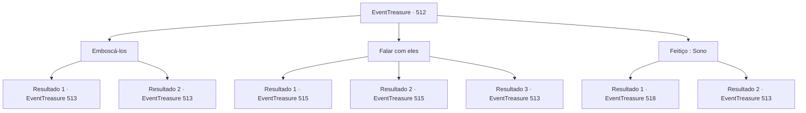

# Eventos de tesouro · 512

[Índice da tabela](index.md) · [Índice geral](../index.md)

ID: `pt:EventTreasure:512` · Fonte: `EventTreasure4` · Versão: 1.2.47.

Mapeamento estático dos arquivos; a disponibilidade e a execução dependem do estado da run.

## Texto do evento

*Sem texto no arquivo.*

## Dados de entrada

```json
{
  "id": 512,
  "grade": 1,
  "place": "",
  "required": ""
}
```

## Mapa das escolhas



## Escolhas e resultados

### Escolha 1

Emboscá-los

Requisitos e outros campos da escolha:

```json
{
  "required": ""
}
```

#### Resultado 1.1

Você se aproxima silenciosamente de um deles, coloca as mãos no pescoço dele e torce. Com um estalo horrível, o bandido cai ao chão, sem vida. Os outros três bandidos se viram, espantados. 

 "Q- que diabos! Quem é você?!"

 Entrando em pânico, eles lutam para sacar suas armas. Você avança contra eles imediatamente, não lhes dando tempo para reagir.

Continuação registrada: [Evento 513](0513.md) na mesma tabela.

```json
{
  "required": "",
  "chance": "1|0_6_1",
  "nextEvent": 513,
  "type": 0,
  "reward": "6_2_135",
  "place": 1
}
```

#### Resultado 1.2

Você tenta se aproximar sorrateiramente de um deles, mas acaba pisando em um galho. O galho se parte ao meio, enquanto os bandidos te avistam na hora. 

 "Que diabos! Quem é você?"

 "Prepare-se para morrer!"

 Eles alcançam suas armas e avançam na sua direção.

Continuação registrada: [Evento 513](0513.md) na mesma tabela.

```json
{
  "required": "",
  "chance": "12",
  "nextEvent": 513,
  "type": 1,
  "reward": "6_0_135",
  "place": 1
}
```

### Escolha 2

Falar com eles

Requisitos e outros campos da escolha:

```json
{
  "required": ""
}
```

#### Resultado 2.1

Você se revela de propósito e fala com eles. Eles sentem seu carisma transbordante — percebendo instintivamente que você não é uma pessoa comum, os bandidos respondem, um tanto intimidados. 

 "Q- Quem é você? Podemos ajudá-lo?"


Continuação registrada: [Evento 515](0515.md) na mesma tabela.

```json
{
  "required": "21_4_4",
  "chance": "1|0_12_1",
  "nextEvent": 515,
  "type": 0,
  "reward": ""
}
```

#### Resultado 2.2

Você se revela de propósito e fala com eles. Eles sentem seu carisma transbordante — percebendo instintivamente que você não é uma pessoa comum, os bandidos respondem, um tanto intimidados. 

 "Q- Quem é você? Podemos ajudá-lo?"


Continuação registrada: [Evento 515](0515.md) na mesma tabela.

```json
{
  "required": "20_4_4",
  "chance": "1",
  "nextEvent": 515,
  "type": 2,
  "reward": ""
}
```

#### Resultado 2.3

Você propositalmente se revela e fala com eles.  Mas eles parecem desinteressados na conversa. 

 "Que diabos! Quem é você?"

 "Prepare-se para morrer!"

 Eles alcançam suas armas e avançam em sua direção.

Continuação registrada: [Evento 513](0513.md) na mesma tabela.

```json
{
  "required": "21_4_4",
  "chance": "20",
  "nextEvent": 513,
  "type": 1,
  "reward": "6_0_135",
  "place": 1
}
```

### Escolha 3

Feitiço : Sono

Requisitos e outros campos da escolha:

```json
{
  "required": "20_0_1|1_1_2"
}
```

#### Resultado 3.1

Você lança um feitiço e os faz todos adormecer. Magicamente, todos largam suas armas e caem no chão. Os desertores começam a roncar profundamente na terra.

Continuação registrada: [Evento 518](0518.md) na mesma tabela.

```json
{
  "required": "",
  "chance": "1|0_7_1|0_12_1",
  "nextEvent": 518,
  "type": 0,
  "reward": "0_1_-1"
}
```

#### Resultado 3.2

Você conjura uma magia e tenta fazê-los dormir. Mas fazer todos dormirem se mostra mais difícil do que você esperava. Os bandidos sentem algo estranho, viram-se e te avistam. — Quem vai lá! Um dos bandidos, que estava prestes a dormir, acorda assustado e alcança sua arma. — Prepare-se para morrer! Eles imediatamente investem contra você com espadas e lanças.

Continuação registrada: [Evento 513](0513.md) na mesma tabela.

```json
{
  "required": "",
  "chance": "24",
  "nextEvent": 513,
  "type": 1,
  "reward": "6_0_135",
  "place": 1
}
```

## Referências que chegam a este evento

- [Evento 511 · escolha 2 · resultado 1](0511.md#escolha-2)
