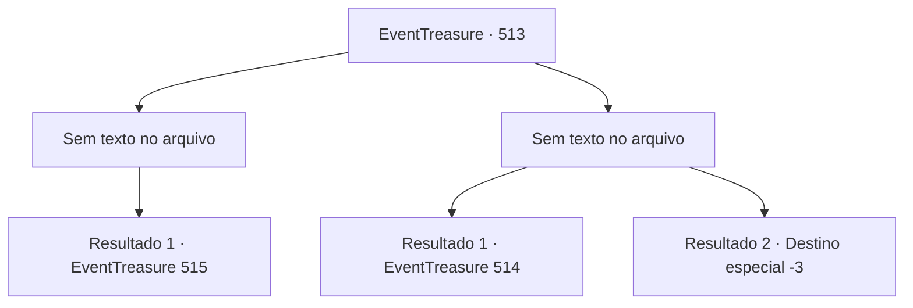

# Eventos de tesouro · 513

[Índice da tabela](index.md) · [Índice geral](../index.md)

ID: `pt:EventTreasure:513` · Fonte: `EventTreasure4` · Versão: 1.2.47.

Mapeamento estático dos arquivos; a disponibilidade e a execução dependem do estado da run.

## Texto do evento

*Sem texto no arquivo.*

## Dados de entrada

```json
{
  "id": 513,
  "grade": 1,
  "place": "",
  "required": ""
}
```

## Mapa das escolhas



## Escolhas e resultados

### Escolha 1

*Sem texto no arquivo; o papel dessa opção depende da interface do jogo.*

Requisitos e outros campos da escolha:

```json
{
  "required": ""
}
```

#### Resultado 1.1

Você dá uma boa surra nos desertores e os põe de joelhos no chão. Eles massageiam os rostos inchados, fazendo o possível para parecer desesperados. 

 "Quem é você... e por que está fazendo isso conosco...?"


Continuação registrada: [Evento 515](0515.md) na mesma tabela.

```json
{
  "required": "",
  "chance": "1",
  "nextEvent": 515,
  "type": 2,
  "reward": ""
}
```

### Escolha 2

*Sem texto no arquivo; o papel dessa opção depende da interface do jogo.*

Requisitos e outros campos da escolha:

```json
{
  "required": ""
}
```

#### Resultado 2.1

Os desertores te dão uma boa surra. Você mal consegue fugir. Ficando confiantes com a vitória, os bandidos riem e xingam pelas suas costas. 

 "NUNCA MAIS SE APROXIME DA GENTE! PAHAHAHA!!"

 Ofegante, você sai da floresta, ainda segurando suas feridas. Seu corpo dói por inteiro. Seus ossos começam a tremer. A dor se espalha por todo o corpo.

Continuação registrada: [Evento 514](0514.md) na mesma tabela.

```json
{
  "required": "1_0_2|1_1_2",
  "chance": "1",
  "nextEvent": 514,
  "type": 2,
  "reward": "0_0_-1|0_1_-1|5_972_1"
}
```

#### Resultado 2.2

Um dos desertores perfura sua barriga com sua lança. Você geme de dor, ofegante e, desesperadamente, busca ar enquanto suas pernas cedem. 

 "Ah... droga. Eu sabia que hoje não ia ser meu dia de sorte."

 O desertor arranca a lança da sua carne e cospe no seu rosto. 

 "Ih, isso vai demorar para limpar."

 Eles começam a discutir o que fazer com seu corpo. Infelizmente, sua consciência se desvanece na escuridão.

Continuação registrada: [Destino especial `-3`](../destinos-especiais.md).

```json
{
  "required": "-1|2_0_2|2_1_2",
  "chance": "1",
  "nextEvent": -3,
  "type": 2,
  "reward": "0_0_-1|0_1_-1"
}
```

## Referências que chegam a este evento

- [Evento 511 · escolha 2 · resultado 2](0511.md#escolha-2)
- [Evento 511 · escolha 3 · resultado 1](0511.md#escolha-3)
- [Evento 512 · escolha 1 · resultado 1](0512.md#escolha-1)
- [Evento 512 · escolha 1 · resultado 2](0512.md#escolha-1)
- [Evento 512 · escolha 2 · resultado 3](0512.md#escolha-2)
- [Evento 512 · escolha 3 · resultado 2](0512.md#escolha-3)
