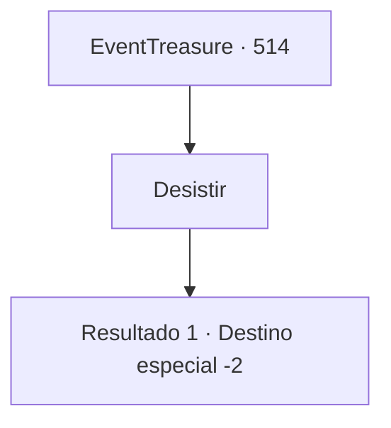

# Eventos de tesouro · 514

[Índice da tabela](index.md) · [Índice geral](../index.md)

ID: `pt:EventTreasure:514` · Fonte: `EventTreasure4` · Versão: 1.2.47.

Mapeamento estático dos arquivos; a disponibilidade e a execução dependem do estado da run.

## Texto do evento

*Sem texto no arquivo.*

## Dados de entrada

```json
{
  "id": 514,
  "grade": 1,
  "place": "",
  "required": ""
}
```

## Mapa das escolhas



## Escolhas e resultados

### Escolha 1

Desistir

Requisitos e outros campos da escolha:

```json
{
  "required": ""
}
```

#### Resultado 1.1

Os moradores da cidade terão que encolher-se de medo por um tempo, mas, por enquanto, você não tem nenhuma solução eficaz. Infelizmente, você decide desistir de lidar com os bandidos.

Continuação registrada: [Destino especial `-2`](../destinos-especiais.md).

```json
{
  "required": "",
  "chance": "1",
  "nextEvent": -2,
  "type": 2,
  "reward": "5_971_9"
}
```

## Referências que chegam a este evento

- [Evento 513 · escolha 2 · resultado 1](0513.md#escolha-2)
