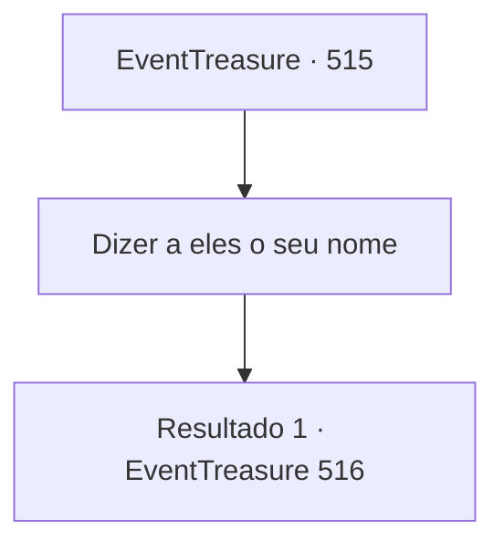

# Eventos de tesouro · 515

[Índice da tabela](index.md) · [Índice geral](../index.md)

ID: `pt:EventTreasure:515` · Fonte: `EventTreasure4` · Versão: 1.2.47.

Mapeamento estático dos arquivos; a disponibilidade e a execução dependem do estado da run.

## Texto do evento

*Sem texto no arquivo.*

## Dados de entrada

```json
{
  "id": 515,
  "grade": 1,
  "place": "",
  "required": ""
}
```

## Mapa das escolhas



## Escolhas e resultados

### Escolha 1

Dizer a eles o seu nome

Requisitos e outros campos da escolha:

```json
{
  "required": ""
}
```

#### Resultado 1.1

Você lhes diz que é o novo Chefe da Casa de Briovich. Os bandidos começam a trocar olhares e largam suas armas. 

 "E-... ah, N... Nós... Quer dizer, nós... hum..."

 Eles te encaram, apavorados. 

 "N- NÓS FERRAMOS TUDO! POR FAVOR NÃO NOS MATEM!"

 Eles se ajoelham e começam a implorar. Acrescentam que, como desertaram da Casa Greymoor, seriam levados a um tribunal marcial se voltassem.

Continuação registrada: [Evento 516](0516.md) na mesma tabela.

```json
{
  "required": "",
  "chance": "1",
  "nextEvent": 516,
  "type": 2,
  "reward": ""
}
```

## Referências que chegam a este evento

- [Evento 512 · escolha 2 · resultado 1](0512.md#escolha-2)
- [Evento 512 · escolha 2 · resultado 2](0512.md#escolha-2)
- [Evento 513 · escolha 1 · resultado 1](0513.md#escolha-1)
