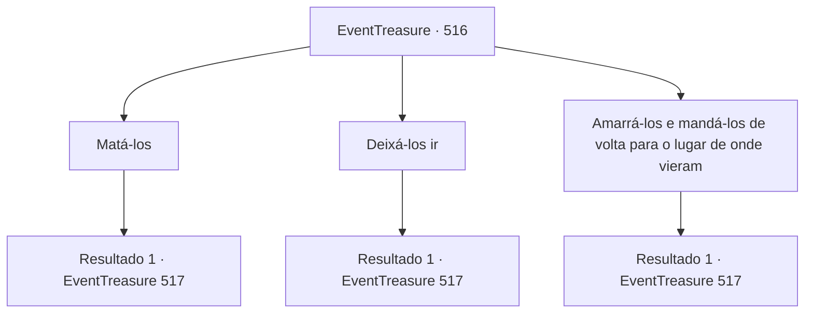

# Eventos de tesouro · 516

[Índice da tabela](index.md) · [Índice geral](../index.md)

ID: `pt:EventTreasure:516` · Fonte: `EventTreasure4` · Versão: 1.2.47.

Mapeamento estático dos arquivos; a disponibilidade e a execução dependem do estado da run.

## Texto do evento

*Sem texto no arquivo.*

## Dados de entrada

```json
{
  "id": 516,
  "grade": 1,
  "place": "",
  "required": ""
}
```

## Mapa das escolhas



## Escolhas e resultados

### Escolha 1

Matá-los

Requisitos e outros campos da escolha:

```json
{
  "required": ""
}
```

#### Resultado 1.1

Você pega uma espada longa do chão e a balança contra um deles. 

 "A...ck...!"

 Os outros ofegam de medo e tentam fugir. Você a balança mais uma vez, cortando as pernas do segundo, e com outro golpe perfura o peito do terceiro. 

 "Gah.... S-socorro..."

 O último tenta rastejar para longe, mas você desfere o golpe final. Todos os bandidos jacem no chão, sem vida.

Continuação registrada: [Evento 517](0517.md) na mesma tabela.

```json
{
  "required": "",
  "chance": "1",
  "nextEvent": 517,
  "type": 2,
  "reward": "0_3_-1"
}
```

### Escolha 2

Deixá-los ir

Requisitos e outros campos da escolha:

```json
{
  "required": ""
}
```

#### Resultado 2.1

Você decide deixar os bandidos irem. Eles batem as cabeças no chão para mostrar gratidão. 

 "H- que gracioso...! Sua misericórdia realmente não conhece limites, obrigado!"

 "Nunca mais seremos bandidos, prometemos!"

 Eles lhe entregam suas armas, como se fizessem um juramento solene. Então, eles se levantam do chão e fogem. Você fica observando até que eles desapareçam de vista.

Continuação registrada: [Evento 517](0517.md) na mesma tabela.

```json
{
  "required": "",
  "chance": "1",
  "nextEvent": 517,
  "type": 2,
  "reward": "3_13_1|3_74_1|3_10_1|0_3_2"
}
```

### Escolha 3

Amarrá-los e mandá-los de volta para o lugar de onde vieram

Requisitos e outros campos da escolha:

```json
{
  "required": ""
}
```

#### Resultado 3.1

Você lhes tira as armas. Então, você os amarra todos com cordas e prende as cordas a um dos cavalos amarrados. Os rostos deles empalidecem. Eles se viram para você, confusos. 

 "T- isso é...?"

 Você os ignora. Você se aproxima do poste de madeira, solta o cavalo e dá um tapa no traseiro dele. Após um longo relincho, o cavalo começa a correr em direção à propriedade Greymoor. Os desertores amarrados gritam maldições enquanto são arrastados.

Continuação registrada: [Evento 517](0517.md) na mesma tabela.

```json
{
  "required": "",
  "chance": "1",
  "nextEvent": 517,
  "type": 2,
  "reward": "3_13_1|3_74_1|3_10_1"
}
```

## Referências que chegam a este evento

- [Evento 515 · escolha 1 · resultado 1](0515.md#escolha-1)
