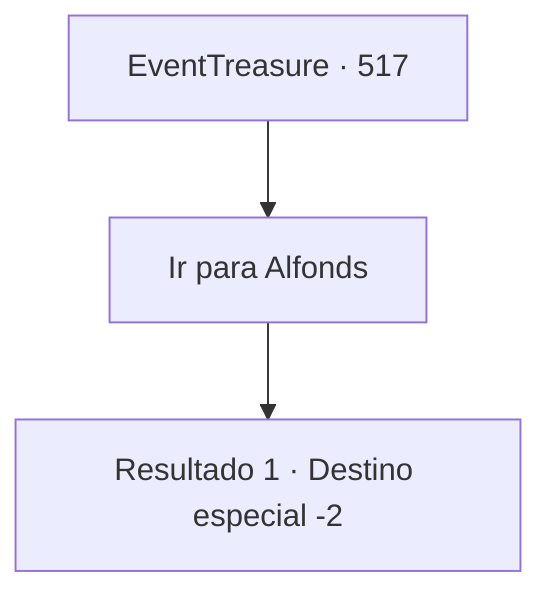

# Eventos de tesouro · 517

[Índice da tabela](index.md) · [Índice geral](../index.md)

ID: `pt:EventTreasure:517` · Fonte: `EventTreasure4` · Versão: 1.2.47.

Mapeamento estático dos arquivos; a disponibilidade e a execução dependem do estado da run.

## Texto do evento

*Sem texto no arquivo.*

## Dados de entrada

```json
{
  "id": 517,
  "grade": 1,
  "place": "",
  "required": ""
}
```

## Mapa das escolhas



## Escolhas e resultados

### Escolha 1

Ir para Alfonds

Requisitos e outros campos da escolha:

```json
{
  "required": ""
}
```

#### Resultado 1.1

Alguns dias depois, você chega ao rio Alfons para se lavar. A água turva cheira a pedras. Você enxuga a água do rosto com as mangas e segue para Alfonds. Os moradores, que certamente estavam esperando por você, lhe dão as boas-vindas de volta. 

 "Oh, meu Senhor...! Você voltou! O que aconteceu com os bandidos?"

 Você lhes diz que os bandidos não vão mais incomodar a região. Os moradores suspiram aliviados. A anciã da cidade se curva para demonstrar gratidão. 

 "Muito obrigado! Nossa cidade finalmente pode relaxar um pouco. Que ótima notícia...!"

 Eles o convidam para uma refeição farta. É um ensopado, preparado com batatas, cenouras, centeio, trigo e frango. Uma refeição feita com carinho, mesmo em tempos de dificuldade. Você aceita a gentileza deles e se junta a eles à mesa. Depois da refeição, você retoma suas aventuras, escoltado pelos moradores. 

 "Se cuida agora, Senhor!"

 Eles se curvam atrás de suas costas.

Continuação registrada: [Destino especial `-2`](../destinos-especiais.md).

```json
{
  "required": "",
  "chance": "1",
  "nextEvent": -2,
  "type": 2,
  "reward": "5_971_9|0_0_1|3_137_1|3_225_1"
}
```

## Referências que chegam a este evento

- [Evento 516 · escolha 1 · resultado 1](0516.md#escolha-1)
- [Evento 516 · escolha 2 · resultado 1](0516.md#escolha-2)
- [Evento 516 · escolha 3 · resultado 1](0516.md#escolha-3)
- [Evento 518 · escolha 1 · resultado 1](0518.md#escolha-1)
- [Evento 518 · escolha 2 · resultado 1](0518.md#escolha-2)
