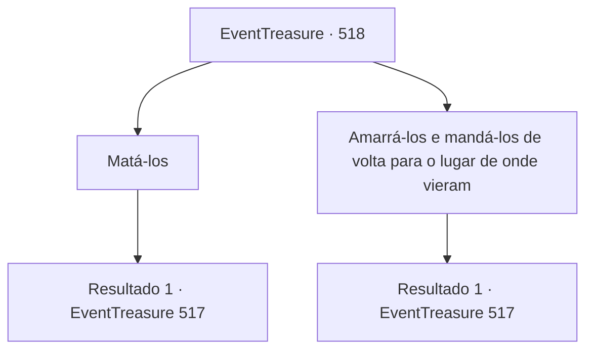

# Eventos de tesouro · 518

[Índice da tabela](index.md) · [Índice geral](../index.md)

ID: `pt:EventTreasure:518` · Fonte: `EventTreasure4` · Versão: 1.2.47.

Mapeamento estático dos arquivos; a disponibilidade e a execução dependem do estado da run.

## Texto do evento

*Sem texto no arquivo.*

## Dados de entrada

```json
{
  "id": 518,
  "grade": 1,
  "place": "",
  "required": ""
}
```

## Mapa das escolhas



## Escolhas e resultados

### Escolha 1

Matá-los

Requisitos e outros campos da escolha:

```json
{
  "required": ""
}
```

#### Resultado 1.1

Você pega uma espada longa do chão e golpeia um deles. 

 "A...ck...!"

 Um, dois, três.. E assim, os três bandidos adormecidos são mortos, sem um único grito.

Continuação registrada: [Evento 517](0517.md) na mesma tabela.

```json
{
  "required": "",
  "chance": "1",
  "nextEvent": 517,
  "type": 2,
  "reward": "0_3_-1"
}
```

### Escolha 2

Amarrá-los e mandá-los de volta para o lugar de onde vieram

Requisitos e outros campos da escolha:

```json
{
  "required": ""
}
```

#### Resultado 2.1

Você amarra os bandidos adormecidos e os coloca a cavalo. Eles não têm ideia do que está acontecendo, imersos em sonhos. Você desamarra o cavalo do poste de madeira e dá um tapa no traseiro dele. Após um longo relincho, o cavalo começa a correr em direção à Greymoor Estate. Você fica observando até que eles não sejam mais visíveis.

Continuação registrada: [Evento 517](0517.md) na mesma tabela.

```json
{
  "required": "",
  "chance": "1",
  "nextEvent": 517,
  "type": 2,
  "reward": ""
}
```

## Referências que chegam a este evento

- [Evento 512 · escolha 3 · resultado 1](0512.md#escolha-3)
