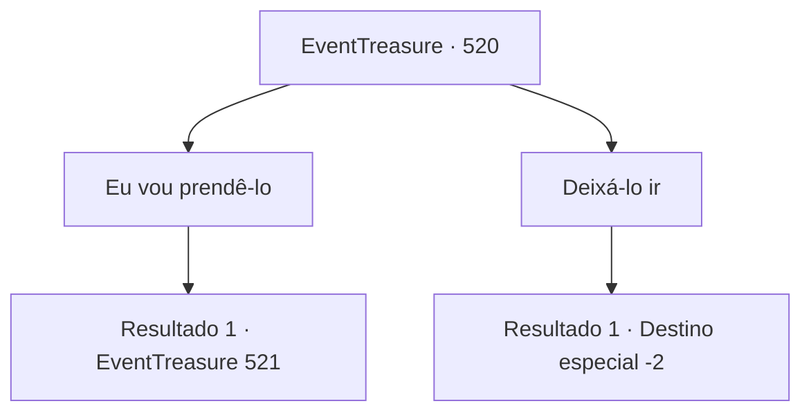

# Eventos de tesouro · 520

[Índice da tabela](index.md) · [Índice geral](../index.md)

ID: `pt:EventTreasure:520` · Fonte: `EventTreasure4` · Versão: 1.2.47.

Mapeamento estático dos arquivos; a disponibilidade e a execução dependem do estado da run.

## Texto do evento

*Sem texto no arquivo.*

## Dados de entrada

```json
{
  "id": 520,
  "grade": 1,
  "place": "",
  "required": ""
}
```

## Mapa das escolhas



## Escolhas e resultados

### Escolha 1

Eu vou prendê-lo

Requisitos e outros campos da escolha:

```json
{
  "required": ""
}
```

#### Resultado 1.1

Você declara que vai prender o Demônio da Espada. O Demônio da Espada lentamente coloca a mão no cabo de sua espada e diz: 

 "Parece que você também está atrás da recompensa. Muito bem, então... tente me capturar. Se conseguir."

 Seu polegar empurra suavemente a guarda da espada. Com um estalo, um clarão frio de luz reluz. Então a lâmina desliza para fora da bainha e voa em sua direção.

Continuação registrada: [Evento 521](0521.md) na mesma tabela.

```json
{
  "required": "",
  "chance": "1",
  "nextEvent": 521,
  "type": 2,
  "reward": "6_0_192",
  "place": 14
}
```

### Escolha 2

Deixá-lo ir

Requisitos e outros campos da escolha:

```json
{
  "required": ""
}
```

#### Resultado 2.1

Você não se dá ao trabalho de deter o Demônio da Espada. Ele desaparece no campo de juncos, e você segue em outra direção.

Continuação registrada: [Destino especial `-2`](../destinos-especiais.md).

```json
{
  "required": "",
  "chance": "1",
  "nextEvent": -2,
  "type": 2,
  "reward": ""
}
```

## Referências que chegam a este evento

- [Evento 472 · escolha 1 · resultado 2](0472.md#escolha-1)
