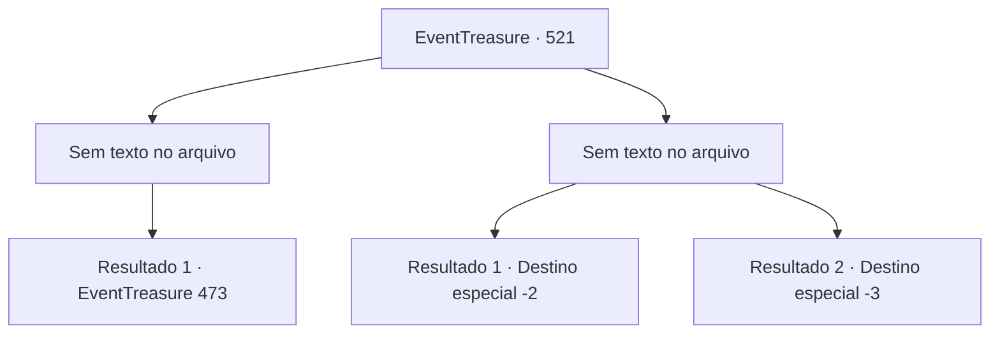

# Eventos de tesouro · 521

[Índice da tabela](index.md) · [Índice geral](../index.md)

ID: `pt:EventTreasure:521` · Fonte: `EventTreasure4` · Versão: 1.2.47.

Mapeamento estático dos arquivos; a disponibilidade e a execução dependem do estado da run.

## Texto do evento

*Sem texto no arquivo.*

## Dados de entrada

```json
{
  "id": 521,
  "grade": 1,
  "place": "",
  "required": ""
}
```

## Mapa das escolhas



## Escolhas e resultados

### Escolha 1

*Sem texto no arquivo; o papel dessa opção depende da interface do jogo.*

Requisitos e outros campos da escolha:

```json
{
  "required": ""
}
```

#### Resultado 1.1

A esgrima do Demônio da Espada é rápida, poderosa e sempre mutável. Seus ataques parecem iguais, mas ele mistura variações inesperadas, esconde golpes surpresa por trás de posturas defensivas, e às vezes mira nos seus pulsos ou tornozelos. No entanto, até mesmo sua esgrima cai diante do seu poder. Sua espada é lançada ao ar, e o Demônio da Espada se ajoelha e admite a derrota. 

 "Eu perdi. Agora me mate. Este é o fim adequado para um verdadeiro guerreiro."

 Um sorriso se espalha por seu rosto. 

 "É uma luta mais agradável do que eu esperava. Agora, corte minha cabeça e pegue a espada. Ela ainda deve estar sedenta."


Continuação registrada: [Evento 473](0473.md) na mesma tabela.

```json
{
  "required": "",
  "chance": "1",
  "nextEvent": 473,
  "type": 2,
  "reward": "5_973_1"
}
```

### Escolha 2

*Sem texto no arquivo; o papel dessa opção depende da interface do jogo.*

Requisitos e outros campos da escolha:

```json
{
  "required": ""
}
```

#### Resultado 2.1

A esgrima do Demônio da Espada era rápida, forte e sempre mutável. Ele repetia ataques, mas misturava variações inesperadas, escondia emboscadas por trás de sua guarda e golpeava com precisão cada fraqueza. Por fim, você não conseguiu resistir à sua habilidade sobrenatural e fugiu. O Demônio da Espada suspirou em desapontamento e embainhou sua lâmina. 

 "Uma pena. Desta vez foi bastante divertido..."

 Felizmente, ele não o perseguiu. Você deixou os juncos e voltou à sua jornada.

Continuação registrada: [Destino especial `-2`](../destinos-especiais.md).

```json
{
  "required": "1_0_2|1_1_2",
  "chance": "1",
  "nextEvent": -2,
  "type": 2,
  "reward": "0_0_-1|0_1_-1"
}
```

#### Resultado 2.2

A esgrima do Demônio da Espada era rápida, forte e sempre mutável. Ele repetia ataques, mas misturava variações inesperadas, escondia emboscadas por trás de sua guarda e golpeava com precisão cada fraqueza. No fim, você caiu diante de sua habilidade assombrosa. O Demônio da Espada suspirou em desapontamento e então, como um raio, desferiu um corte. 

 "Uma pena. Desta vez foi bem divertido..."

 Sua lâmina cortou sua garganta, e o sangue jorrou. O mundo girou uma vez antes de você desabar.

Continuação registrada: [Destino especial `-3`](../destinos-especiais.md).

```json
{
  "required": "-1|2_0_2|2_1_2",
  "chance": "1",
  "nextEvent": -3,
  "type": 2,
  "reward": "0_0_-1|0_1_-1"
}
```

## Referências que chegam a este evento

- [Evento 519 · escolha 1 · resultado 1](0519.md#escolha-1)
- [Evento 520 · escolha 1 · resultado 1](0520.md#escolha-1)
